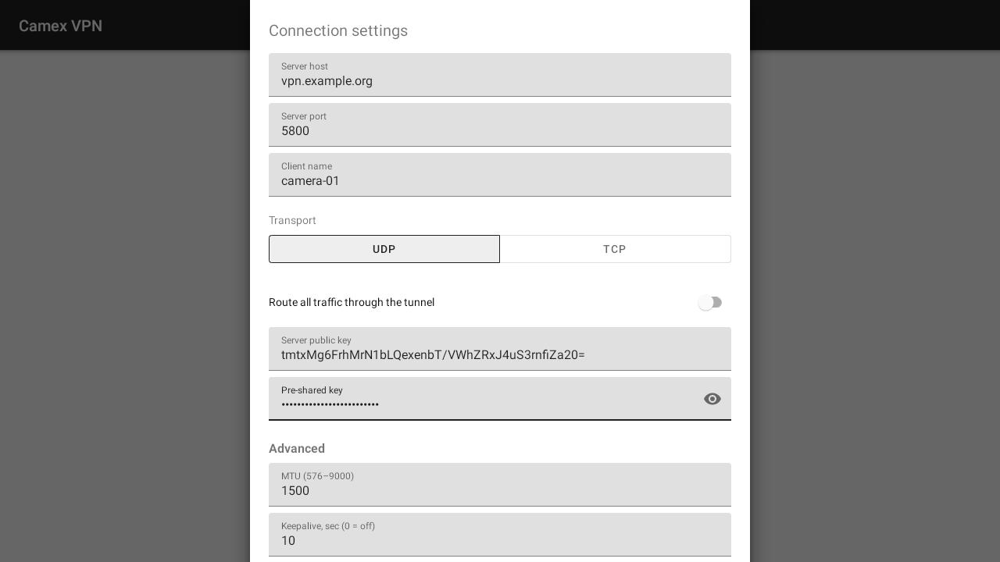

![OpenIPC logo][logo]

# OpenIPC Camex

[English](README.md) | [Русский](README.ru.md) | **简体中文**

[](https://github.com/OpenIPC/camex/actions/workflows/build.yml)
[](https://github.com/OpenIPC/camex/releases/latest)
[](LICENSE)
[](https://github.com/OpenIPC/camex)

面向嵌入式 Linux 目标设备的极简、无外部依赖的 UDP/TCP 隧道。

以用户态守护进程的形式提供，并附带一个可选的独立内核模块。

---

## 功能特性

- **客户端/服务器架构**，基于 UDP 或 TCP
- **自动配置模式** —— 客户端从服务器获取隧道参数
- **协议 v2** —— Noise 握手（`NKpsk0`、X25519、ChaCha20-Poly1305、BLAKE2b），
  每个会话、每个方向使用新的密钥，始终加密
- **无外部依赖** —— 仅需 libc
- **跨平台构建** —— x86_64、ARM、AArch64、MIPS（通过 CI）
- **自研内核模块** —— `camex.ko` 可替代 `tun.ko`，无外部依赖
- **代码精简** —— 总计约 3,500 行，便于审计

## 快速上手

### 密钥

服务器拥有一对密钥；每个客户端都需要服务器的**公钥**以及预共享密钥（全局密钥，
或服务器配置中该客户端自己的 `psk=`）。

```sh
(umask 077; camex --genkey > server.key)   # server_key=…（保密）和 public_key=…
```

### 服务器

```sh
sudo ./camex --mode server --port 5800 --config /etc/camex/camex.conf \
  --server-key-file server.key --psk secret
```

### 客户端（自动模式）

```sh
sudo ./camex --mode client --auto --name 0203A104B5AE \
  --server-host vpn.example.org --port 5800 \
  --server-pubkey <public_key> --psk secret
```

### 客户端（手动模式）

```sh
sudo ./camex --mode client \
  --local-cidr 10.0.0.2/24 --gateway-ip 10.0.0.1 \
  --server-host vpn.example.org --port 5800 \
  --server-pubkey <public_key> --psk secret
```

### Android

应用以自动模式连接：地址、路由和 MTU 由服务器下发。

| 主界面                                  | 设置                                      |
|-----------------------------------------|-------------------------------------------|
|  |  |

- **Server host / port** — camex 服务器。
- **Client name** — 客户端 ID，即服务器上的 `[client ID]` 块。
- **Transport** — UDP 或 TCP，与服务器一致。
- **Server public key** 和 **Pre-shared key** — 对应 `--server-pubkey --psk`；
  密钥必须与该客户端的 `psk=`（或全局密钥）一致。
- **Route all traffic through the tunnel** — 关闭时，只有隧道网络和服务器下发的
  路由经过隧道。
- **Advanced** — MTU、keepalive 和服务器超时
  （[截图](docs/images/android-settings-advanced.png)）。

## 永久链接

二进制文件只发布在一个版本中：[`latest`](https://github.com/OpenIPC/camex/releases/latest)，
CI 会在每次推送到 `master` 时重新构建。其标题显示 camex 版本（`Camex X.Y.Z`）；
文件名不含版本号，因此以下链接始终不变：

- 发布页面：`https://github.com/OpenIPC/camex/releases/latest`
- 单个文件：`https://github.com/OpenIPC/camex/releases/latest/download/<文件>`

| 文件                       | 平台                                                          |
|----------------------------|---------------------------------------------------------------|
| `camex-aarch64`            | Linux AArch64，静态链接（musl）                               |
| `camex-arm`                | Linux 32 位 ARM，静态链接（musl）：OpenIPC 摄像头             |
| `camex-mipsel`             | Linux MIPS 小端，静态链接（musl，软浮点）：君正摄像头、路由器 |
| `camex-x86_64`             | Linux x86_64，静态链接（musl）                                |
| `camex-android.apk`        | Android 8.0 及更高版本                                        |
| `camex-macos.zip`          | macOS（utun）：`camex`、LICENSE、README                       |
| `camex-windows-x86_64.zip` | Windows 64 位：`camex.exe` 和 `wintun.dll`                    |
| `camex-windows-i686.zip`   | Windows 32 位：`camex.exe` 和 `wintun.dll`                    |

```sh
URL=https://github.com/OpenIPC/camex/releases/latest/download
curl -fL -O $URL/camex-arm
```

变更历史见 [CHANGELOG.md](CHANGELOG.md)。

## 二进制大小

| 平台    | 工具链                               | 大小    |
|---------|--------------------------------------|---------|
| x86_64  | Bootlin x86-64 musl                  | ~195 KB |
| arm     | OpenIPC arm musleabi                 | ~200 KB |
| aarch64 | Bootlin aarch64 musl                 | ~205 KB |
| mipsel  | OpenWrt mipsel_24kc musl, soft-float | ~230 KB |

发布的二进制文件使用 musl 静态链接：设备上不需要 libc，可在任何 OpenIPC
固件上运行。它们未使用 UPX 压缩，因此每次启动时无需解压到内存。由
`ci/build-musl.sh` 构建；准确大小见每次
[CI 运行](https://github.com/OpenIPC/camex/actions)的大小报告。

## 系统要求

| 要求       | 说明                                                                                                                           |
|------------|--------------------------------------------------------------------------------------------------------------------------------|
| Linux 内核 | 3.10 或更高版本                                                                                                                |
| TUN 支持   | `CONFIG_TUN=y`（`/dev/net/tun`）**或**已加载 `camex.ko`（`/dev/camex`）                                                        |
| 权限       | `root` 或 `CAP_NET_ADMIN` + `CAP_NET_RAW`（非 root 使用 `camex.ko` 时还需要 `/dev/camex` 的访问权限，见[内核模块](#内核模块)） |
| C 编译器   | 兼容 C99（GCC 或 Clang）                                                                                                       |

## 构建

### 用户态程序

```sh
make
```

### 内核模块（可选）

```sh
# 前提条件：内核头文件
make kmod
```

### 同时构建两者

```sh
make && make kmod
```

### 交叉编译

```sh
make CROSS_COMPILE=mipsel-linux-
```

为嵌入式内核（OpenWrt 等）构建内核模块，请参阅
[为嵌入式内核构建](#为嵌入式内核构建openwrt-等)。

### 安装内核模块

```sh
sudo make kmod-install
```

### 清理

```sh
make clean          # 删除用户态构建产物
make kmod-clean     # 删除内核模块构建产物
make distclean      # 清理全部
```

## TUN 驱动支持

程序启动时会自动检测可用的 TUN 后端。它首先尝试 `/dev/net/tun`
（tun.ko）；如果失败或 TUNSETIFF 不可用，则回退到
`/dev/camex`（camex.ko）。从协议角度看，两种后端的行为完全一致。

可通过 `--tun-dev <path>` 覆盖自动检测：

```sh
sudo ./camex --mode client ... --tun-dev /dev/camex
```

| 特性                 | tun.ko（`/dev/net/tun`）         | camex.ko（`/dev/camex`） |
|----------------------|----------------------------------|--------------------------|
| 接口名称             | 动态（`tun0`、`tun1`……）         | 固定为 `camex`           |
| 需要 TUNSETIFF ioctl | 是                               | 否                       |
| 外部依赖             | `CONFIG_TUN=y` 或已加载 `tun.ko` | 已加载 `camex.ko`        |
| IPv4                 | 是                               | 是                       |
| IPv6                 | 是                               | 否（仅 IPv4）            |
| 多实例               | 是                               | 否（单个）               |
| 裸 IPv4 数据包       | 是（配合 `IFF_NO_PI`）           | 是                       |

## 用户态程序

### 运行模式

| 模式     | 说明                           |
|----------|--------------------------------|
| `client` | 创建 TUN 接口并连接到服务器    |
| `server` | 监听多个客户端并转发隧道数据包 |

### 用法

#### 客户端

```sh
sudo ./camex \
  --mode client \
  --auto \
  --name 0203A104B5AE \
  --server-host vpn.example.org \
  --port 5800 \
  --server-pubkey <public_key> --psk secret
```

手动客户端模式：

```sh
sudo ./camex \
  --mode client \
  --local-cidr 10.0.0.2/24 \
  --gateway-ip 10.0.0.1 \
  --server-host vpn.example.org \
  --port 5800 \
  --route-cidr 192.168.100.0/24 \
  --server-pubkey <public_key> --psk secret
```

显式指定 TUN 后端：

```sh
sudo ./camex \
  --mode client \
  --local-cidr 10.0.0.2/24 \
  --gateway-ip 10.0.0.1 \
  --server-host vpn.example.org \
  --port 5800 \
  --server-pubkey <public_key> --psk secret \
  --tun-dev /dev/camex
```

#### 服务器

```sh
sudo ./camex \
  --mode server \
  --port 5800 \
  --bind-ip 0.0.0.0 \
  --config /etc/camex/camex.conf \
  --server-key-file /etc/camex/server.key \
  --psk secret
```

### 选项

| 选项                       | 短选项 | 说明                                                                                                                                          |
|----------------------------|--------|-----------------------------------------------------------------------------------------------------------------------------------------------|
| `--mode <mode>`            | `-M`   | 运行模式：`client` 或 `server`（必填）                                                                                                        |
| `--auto`                   | `-a`   | 从服务器获取隧道参数                                                                                                                          |
| `--name <id>`              | `-n`   | 自动模式下使用的客户端 ID                                                                                                                     |
| `--local-cidr <cidr>`      | `-l`   | 隧道地址，格式为 `address/prefix`                                                                                                             |
| `--gateway-ip <addr>`      | `-g`   | 隧道内的客户端网关                                                                                                                            |
| `--server-host <addr>`     | `-s`   | 客户端模式下的服务器主机名或 IP                                                                                                               |
| `--port <port>`            | `-p`   | 客户端模式下为服务器端口，服务器模式下为监听端口                                                                                              |
| `--bind-ip <addr>`         | `-b`   | 服务器绑定地址（默认：0.0.0.0）                                                                                                               |
| `--config <path>`          | `-f`   | 服务器配置文件路径                                                                                                                            |
| `--route-cidr <cidr>`      | `-c`   | 在客户端上额外添加的路由；可重复指定                                                                                                          |
| `--mtu <size>`             | `-t`   | 隧道 MTU，576–9000（默认：1500）                                                                                                              |
| `--psk <key>`              | `-k`   | 预共享密钥：`hex:<64 位十六进制>`、`base64:<44 个字符>` 或口令（Argon2id 拉伸）。客户端必填                                                   |
| `--server-pubkey <key>`    |        | 客户端：服务器的公钥（来自 `--genkey`）                                                                                                       |
| `--server-key-file <path>` |        | 服务器：私钥文件（或 `[server]` 中的 `server_key=`）                                                                                          |
| `--genkey`                 |        | 输出一对新的服务器密钥（`server_key=`、`public_key=`）后退出                                                                                  |
| `--encrypt`                | `-e`   | 为兼容而保留：协议 v2 始终加密                                                                                                                |
| `--tun-dev <path>`         | `-T`   | TUN 设备路径（默认：先自动检测 `/dev/net/tun`，再检测 `/dev/camex`）                                                                          |
| `--pid-file <path>`        | `-P`   | 启动时将 PID 写入文件                                                                                                                         |
| `--status`                 |        | 列出本机所有服务器的已连接客户端后退出（以服务器的用户运行，通常为 root）                                                                     |
| `--json`                   |        | 与 `--status` 一起使用：以 JSON 输出，便于脚本处理                                                                                            |
| `--control <path>`         |        | 服务器：`--status` 使用的控制套接字（默认 `/run/camex/camex-<transport>-<port>.sock`，`none` 为关闭）；与 `--status` 一起使用：只查询该服务器 |
| `--bind-dev <iface>`       | `-d`   | 将套接字绑定到指定网络接口（`SO_BINDTODEVICE`）                                                                                               |
| `--transport <proto>`      | `-R`   | 传输协议：`udp`（默认）或 `tcp`                                                                                                               |
| `--version`                | `-v`   | 打印版本号并退出                                                                                                                              |
| `--help`                   | `-h`   | 打印用法并退出                                                                                                                                |

## 示例

`examples/` 目录中提供了开箱即用的配置文件：

| 文件                     | 说明                              |
|--------------------------|-----------------------------------|
| `examples/camex.conf`    | 服务器端配置文件格式参考          |
| `examples/camex.service` | camex 守护进程的 systemd 服务单元 |
| `examples/README.md`     | 所有示例的使用说明                |

## 服务器配置

服务器读取扁平的 key=value 配置文件，每个块对应一条客户端记录。
完整格式请参见 `examples/camex.conf`。

```sh
sudo ./camex --mode server --port 5800 --config /etc/camex/camex.conf
```

自动模式的客户端从配置文件获取地址。ID 没有对应 `[client ID]` 块的客户端
使用 `[defaults]`；若未配置地址，则从自动地址池中分配，默认为
`10.200.0.2`–`10.200.0.254`（跳过已占用的地址和 `[client ID]` 块中的地址；离开的
客户端的地址仍按其 ID 保留，返回时会拿回该地址）。若只想为配置文件中列出的 ID 提供服务，请在 `[server]`
块中设置 `allow_unknown_clients=no`。

修改配置文件后，向服务器发送 `kill -HUP`。正在运行的自动模式客户端会在下一次
握手时（密钥更新，最多 10 分钟后，或重新连接）获取变更后的地址、网关、MTU 或
路由：它会用新设置重新打开隧道并替换路由，无需重启。在客户端通过新会话中的第一个数据包
确认新地址之前，旧地址仍然有效。

### 已连接的客户端（`--status`）

服务器监听一个本地控制套接字，默认为 `/run/camex/camex-<transport>-<port>.sock`
（`udp` 或 `tcp`；macOS 上为 `/var/run/camex`），权限为 `0600`：只有服务器的用户
（通常为 root）可以使用。同一主机上的多个服务器（例如 UDP 和 TCP）各有自己的套接字；
使用 `--bind-ip` 或 `--bind-dev` 的服务器，其名称中还包含地址或接口
（`camex-udp-192.0.2.1-5800.sock`）。`[server]` 中的 `control_socket=<path>` 或
`--control <path>` 可修改路径，`none` 为关闭；重新加载配置时生效，若新路径不可用则保留
原套接字。Windows 上不可用。

```sh
sudo camex --status          # 本机所有服务器的客户端
sudo camex --status --json   # 以 JSON 输出，便于脚本和监控
sudo camex --status --control /run/camex/camex-udp-5800.sock   # 只查询一个服务器
```

```
camex 3.3.0 server, udp port 5800, tunnel 10.200.0.1/24, pool 10.200.0.0/24, up 2h05m, clients 2, slots 2 of 256

ID     MODE    KEY     ADDRESS          PEER                CONNECTED  LAST       HANDSHAKE     HS          RX   RX PKTS          TX   TX PKTS
CAM-A  auto    global  10.200.0.2       203.0.113.7:50997   2h04m      3s         4m10s         13     1.2 MiB      9120     8.4 MiB     12480
CAM-B  auto    own     10.200.0.3       198.51.100.4:41022  12m03s     1s         2m02s          2   310.5 KiB      2210     2.0 MiB      3105

Addresses kept for clients that are gone (#81): 1
CAM-C  10.200.0.4       gone 6m40s
```

在客户端确认新地址之前，`ADDRESS` 显示为 `旧 -> 新`。`LAST` 是距其最后一个数据包（含 keepalive；首个数据包之前为 `-`）的
时间，`HANDSHAKE` 是距其最后一次密钥更新的时间，`HS` 是握手次数；`RX` 是从该客户端
收到的隧道数据，`TX` 是发往它的数据，单位为字节和包数。保留的地址属于已离开的客户端：客户端返回时会拿回自己的地址。

`--json` 输出 `{"servers":[...]}`，每个服务器一个对象：`version`、`pid`、
`transport`、`port`、`tunnel`、`pool`、`started`（Unix 时间）、`uptime`、
`slots`（`used` 含尚未握手的 TCP 连接，以及 `max`）、`clients` 和 `leases`。每个客户端包含 `id`（无 ID 的手动
客户端为 `null`）、`mode`（`auto` 或 `manual`）、`key`（`global` 或 `own`）、
`address`、`pending` 和 `previous`（或 `null`）、`peer`、`transport`、`registered`
（首次握手的 Unix 时间）、`connected_s`（当前连接）、`last_packet_s`（首个数据包之前为 `null`）、`last_handshake_s`、`handshakes`、
`rx_packets`、`rx_bytes`、`tx_packets`、`tx_bytes`；每个保留地址包含 `id`、
`address`、`gone_s` 和 `previous`（客户端上一会话的地址为 `true`）。

### 自动地址池与客户端数量

`[server]` 中的两个键用于按网络规模配置服务器：

- `auto_pool=<网络>/<前缀>` —— 自动地址池，前缀从 `/8` 到 `/30`；默认为
  `10.200.0.0/24`。第一个地址是客户端获得的网关，请通过 `--local-cidr` 或
  `local_cidr=` 把它分配给服务器（默认地址池为 `10.200.0.1/24`）。客户端获得从第二个
  到倒数第二个的地址，并使用地址池的前缀（`10.50.0.0/16` 中的 `10.50.3.7/16`）。
  如果服务器的隧道地址不是地址池的网关，或地址池不在其隧道网络内，服务器会在启动时
  和重新加载配置后发出警告。重新加载新的地址池后，自动模式客户端会在下一次握手时
  迁移到新地址池。
- `max_clients=<n>` —— 客户端槽位数，从 1 到 65534；默认为地址池中的地址数，但不少于
  256（`/24` 及更小的地址池保持 256）。仅在启动时读取；重新加载配置时若要求不同的数量，
  服务器会提示需要重启。使用 TCP 时服务器使用 `select()`，最多保留 `FD_SETSIZE` − 32 个槽位
  （Linux 上为 992），且不超过打开文件数限制所允许的数量（它会把软限制提高到硬限制），
  并在日志中说明。

```ini
[server]
local_cidr=10.50.0.1/16
# 65533 个客户端地址和同样多的槽位
auto_pool=10.50.0.0/16
```

每个槽位约占 1.3 KB，每个 `[client ID]` 块约占 0.7 KB：256 个槽位约 330 KB，
65534 个约 85 MB。查找客户端的开销与客户端数量无关。大型网络适用于 PC 或服务器；
在路由器上请保留默认的 `/24`。服务器会锁定自身内存（`mlockall`），以免密钥被换出到
swap；请为槽位和配置提供足够的内存锁定上限（root 不受限制；否则使用 `ulimit -l`、systemd 中的
`LimitMEMLOCK=infinity`、Docker 中的 `--cap-add IPC_LOCK` 或 `--ulimit memlock=-1`），
否则服务器将在不锁定内存的情况下运行，并在日志中写入 `SECURITY WARNING`。当有数千个
`[client ID]` 块时，请用 `hex:` 或 `base64:` 密钥设置其 `psk=`：每个口令在服务器启动时
都要运行一次 Argon2id（8 MiB，数十毫秒），重新加载配置时超出其缓存的 260 个密钥的部分
也需要重新计算。握手会依次尝试各个密钥（总是先尝试全局密钥），所有握手合计每秒最多尝试
51200 次每客户端密钥，若密钥更多则为其数量的四倍：每客户端密钥适用于数十到数百个客户端；
对于数千个客户端，请使用全局密钥（仍可通过 ID 区分它们），只在需要的地方使用每客户端密钥。

每个数据包中的会话索引在低 16 位携带客户端的槽位号（高 16 位为随机数），因此服务器
无需搜索即可找到数据包对应的会话。

## 安全模型

camex 是面向摄像机的小型隧道，而不是通用 VPN。在把它暴露到不受信任的网络之前，
请先了解它能保护什么。

### 协议 v2（camex 3.x）

- **握手。** `Noise_NKpsk0_25519_ChaChaPoly_BLAKE2b`：客户端知道服务器的公钥，
  双方都知道客户端的预共享密钥。每个会话都使用新的密钥，且每个方向的密钥不同
  （前向保密：密钥泄露后也无法解密已记录的会话）。
- **数据包。** ChaCha20-Poly1305：负载被加密，17 字节的头部（类型、会话索引、
  计数器）经过认证但仍可读。认证失败的数据包会被丢弃。密钥每 10 分钟更新一次。
- **密钥。** 预共享密钥可以是原始密钥（`hex:`、`base64:`），也可以是经 Argon2id
  拉伸的口令。截获的握手无法用于离线猜测口令：这需要服务器的私钥。
- **按客户端的密钥。** `[client ID]` 块中的 `psk=` 为该客户端设置专属密钥：它
  只能用该密钥注册，全局密钥对该 ID 不再有效（除非两个口令相同，此时它们是同一
  个密钥）。具体规则见[说明](#说明)。
- **源地址。** 客户端只能以自己的隧道地址作为源地址发送数据包；其他源地址的
  数据包会被丢弃。
- **防重放。** 每个会话的数据包有 2048 个数据包的窗口。客户端有活动会话时，
  带有旧时间戳的握手会被拒绝；被重放的握手无法接管正在工作的会话：新会话只有
  在收到客户端在其上的第一个数据包后才替换旧会话（重启后时钟回退的客户端仍能
  重新连接）。已结束会话的数据包无法被注入新会话：新会话的密钥不同。
- **漫游。** 会话按索引而不是按客户端地址查找：NAT 地址变化后客户端仍保持会话。
- **重新加载配置。** 收到 `SIGHUP` 后，如果某个活动会话的密钥已被删除、更改，
  或现在属于另一个客户端，该会话会被结束。

### 不受保护的内容

- **服务器私钥**的持有者可以对知道预共享密钥的客户端冒充服务器：请妥善保管
  `server_key`。
- **元数据。** 数据包大小、时间、端点以及明文头部（数据包类型、会话索引、
  计数器）是可见的。
- **没有不加密的模式**；如需不加密的开放隧道，请使用 OpenIPC VTesse。
- **隧道内部**的流量不做过滤：任何客户端都可以访问服务器和隧道网络中的其他
  客户端。请在服务器的隧道接口上用防火墙加以限制（使用 `/dev/net/tun` 时为
  `tun0` 等，使用内核模块时为 `camex`；服务器启动时会在日志中输出接口名）。

### 拒绝服务方面的限制

- 尚未完成握手的 TCP 连接受到限制（每个源地址 4 个，总共 32 个），并在 10 秒后
  关闭。握手带有以服务器公钥为密钥的 MAC：不知道该公钥的人发送的数据包只需一次
  哈希即被丢弃。服务器每秒最多处理 200 次握手。由于每个客户端都知道该公钥，握手和
  密钥尝试的预算按来源分配：未知来源合计最多占各自的 3/4，单个地址最多 1/8，单个
  `/24` 最多 1/4（但至少足以把所有密钥尝试一遍）。从自身地址更新密钥的在线客户端
  保留其余部分（每秒最多 4 次握手），并且（在全局密钥之后）优先尝试它自己的密钥，
  因此来自其他地址的握手洪泛不会阻止它。
  因此，位于同一 NAT 地址之后、使用全局密钥的摄像机每秒最多连接 25 台（例如断电之后）；
  使用每客户端密钥时，新握手可能要尝试所有密钥，单个地址每秒约有
  max(51200/8, 密钥数量) 次密钥尝试：密钥有数千个时每秒只能连接几台。其余的会重试。
- 对端可以触发的日志消息（被丢弃的数据包、被拒绝的注册）有速率限制；被抑制
  的数量会记录到日志中。
- 自动地址池只分配其网络中的客户端地址（默认为 `10.200.0.2`–`.254`），绝不会把同一
  地址分配给两个客户端（#81）：
  - 客户端会话结束时（静默 120 秒、TCP 连接关闭、其槽位被需要），其地址仍为其 ID
    保留：只要地址池还有其他空闲地址，就不会分给其他客户端，且 12 分钟内无论如何
    都不会；客户端返回时会拿回该地址；
  - 服务器启动后的 60 秒内，客户端只能获得它请求的地址（其原地址），因此返回的
    客户端会在新客户端占用地址之前回来；新客户端会等待并重试；
  - 若重新加载配置把某个在线客户端的地址分配给 `[client ID]` 的 `local_cidr`，
    该客户端的会话会结束（它会以另一个地址返回），在地址仍被占用期间该配置的
    客户端会被拒绝；
  - 手动模式客户端不能占用在线客户端的地址（只有同一个手动客户端，使用相同的 ID
    和密钥，才能接管其条目）；
  - 以上仅在同一个服务器内成立：两个服务器（例如一个 UDP、一个 TCP）互不知道对方的
    客户端，因此请为每个服务器设置各自的 `auto_pool=` 网络。
- `allow_unknown_clients=no` 只为配置文件中
  列出的自动模式 ID 提供服务（手动模式客户端受其密钥和地址约束，见[说明](#说明)）。

### 推荐的部署方式

- 服务器密钥文件只允许服务器读取（`umask 077`）；只把 `public_key` 交给客户端。
- 优先使用原始密钥（`hex:`/`base64:`）或长的随机口令。
- 在 `[client ID]` 块中为每台摄像机设置自己的 `psk=`，并在所有自动模式摄像机都
  已列出时设置 `allow_unknown_clients=no`。
- 只以所需的权限运行服务器（`CAP_NET_ADMIN`；使用内核模块时还需要对
  `/dev/camex` 的文件访问权限，见下文），并用防火墙保护隧道接口。

### 内核模块权限

`/dev/camex` 以 `0600` 权限创建，`open()` 需要 `CAP_NET_ADMIN`；参见
[关键设计决策](#关键设计决策)。该模块不做加密：加密由用户态应用完成。

### Android 应用

应用使用 `VpnService`，因此隧道建立期间 Android 会显示 VPN 钥匙图标；使用
`VpnService` 时无法去掉它（无 TUN 的客户端见 #21）。只有隧道网络和服务器下发的
路由会经过隧道；除非在设置中启用 **Route all traffic through the tunnel**，否则
服务器下发的 `0.0.0.0/0` 路由会被忽略。该开关只作用于 IPv4：IPv6 流量不经过隧道。

## 内核模块

### 架构

```
Userspace                          Kernel
──────────────────                 ──────────────────────────────────────────
                                   ┌─────────────────────────────────┐
  write(fd, ipv4_pkt)  ──────────► │  copy_from_user()               │
                                   │  netif_rx(skb)                  │
                                   │       │                         │
                                   │       ▼                         │
                                   │  IP stack / routing             │
                                   │       │                         │
                                   │       ▼                         │
                                   │  camex_net_xmit()               │
                                   │  enqueue → rx_queue             │
                                   │  wake_up(rx_wait)               │
  read(fd, buf)        ◄────────── │  copy_to_user()                 │
                                   └─────────────────────────────────┘
  poll/select/epoll    ◄────────── wait_queue (rx_wait)

  /dev/camex  ←────────────────────────────────────── net interface "camex"
```

两个相互独立的内核对象——字符设备（`miscdevice`）和
网络接口（`net_device`）——共享同一个 `camex_priv`
实例。二者之间的通信通过受 `spinlock` 保护的 `rx_queue`
完成。

### 关键设计决策

#### 1. 不依赖 `tun.ko`

上游的 `/dev/net/tun` 是一个独立模块（`drivers/net/tun.c`），
必须加载该模块或将其编译进内核。camex 直接注册
自己的 `net_device` 和 `miscdevice`，只使用内核核心
子系统（`netdev`、`misc`、`skbuff`），这些子系统**始终存在**，
无法被卸载或禁用。

#### 2. 使用 `miscdevice` 而非手动注册 `chrdev`

使用 `misc_register()` 可以自动：
- 动态分配次设备号（不会冲突）；
- 通过 udev/devtmpfs 创建 `/dev/camex`，无需任何 udev 规则；
- 将权限设为 `0600`（仅 root）。

`open()` 还要求 `CAP_NET_ADMIN`：该设备会向网络协议栈注入数据包并暴露
被路由的流量，这属于网络管理操作，与配置 tun 设备相同。

以非 root 用户运行并具有 `CAP_NET_ADMIN` + `CAP_NET_RAW` 的守护进程
还需要设备节点的文件访问权限，而 `0600` 不提供该权限。可以通过 udev
规则把访问权限授予专用用户组（capability 检查仍然有效）：

```sh
# /etc/udev/rules.d/90-camex.rules
KERNEL=="camex", GROUP="camex", MODE="0660"
```

或者不使用 udev，在每次 `insmod` 之后执行：`chgrp camex /dev/camex && chmod 0660 /dev/camex`。

#### 3. 使用 `spinlock` + `irqsave` 保护数据包队列

`camex_net_xmit()` 在 softirq 上下文（而非进程上下文）中被调用，
因此使用 `spin_lock_irqsave` 而不是 mutex 来保护队列。
这样可以避免在中断上下文中调用时发生死锁。

#### 4. 通过 `wait_event_interruptible` 实现阻塞式 `read()`

没有采用忙等待或定时器，而是使用内核的标准机制：
进程在 `wait_queue` 上睡眠，由 `camex_net_xmit()`
通过 `wake_up_interruptible()` 唤醒。信号可以正确中断
等待（`-ERESTARTSYS`）。

#### 5. 仅支持 IPv4，并在 `write()` 时显式校验

在 `write()` 中，会先通过 `get_user()` 检查缓冲区的第一个字节，
然后才执行 `copy_from_user`。如果 IP 版本不是 4，
则直接返回 `-EINVAL`，不分配 `skb`，从而防止垃圾数据
或非 IPv4 数据包进入协议栈。

#### 6. 单用户（`EBUSY`）

`g_priv->attached` 是通过 `atomic_cmpxchg()` 获取的 `atomic_t`。
如果 `/dev/camex` 已被打开，后续的 `open()` 会立即返回 `-EBUSY`，
两个并发的 `open()` 绝不会同时成功。`close()` 时，队列的清空和槽位的
释放在 `camex_net_xmit()` 使用的同一把锁下完成，因此下一次 `open()`
不会读到旧的数据包。

#### 7. `ARPHRD_NONE` + `IFF_NOARP`

该接口被声明为没有链路层地址。内核不会尝试解析
MAC 地址（ARP），也不会添加以太网头。用户态收发的是
从版本字节 `0x45...` 开始的**裸 IPv4 数据报**。

#### 8. 通过 `#define` 垫片实现兼容

所有 `#if LINUX_VERSION_CODE` 判断都集中在文件顶部的一个
`#define` 块中。驱动主体只使用宏名
（`CAMEX_ALLOC_NETDEV`、`CAMEX_POLL_T`、`CAMEX_SKB_PUT` 等），
函数内部没有任何条件编译。这简化了审计和
维护工作。

### 内核兼容性

| 版本范围      | 状态 | 适配的 API                                          |
|---------------|------|-----------------------------------------------------|
| 3.10 – 3.16   | ✅   | `alloc_netdev(sz, name, setup)` —— 3 个参数         |
| 3.17 – 3.19   | ✅   | `alloc_netdev` + `NET_NAME_PREDICTABLE` —— 4 个参数 |
| 4.0  – 4.9    | ✅   | `net_device` 中没有 `min_mtu`/`max_mtu` 字段        |
| 4.10 – 4.15   | ✅   | 引入 `min_mtu`/`max_mtu` 字段                       |
| 4.16 – 4.19   | ✅   | `poll` 返回 `__poll_t`；使用 `EPOLL*` 常量          |
| 4.20+         | ✅   | `skb_put()` 返回 `void*` 而非 `unsigned char*`      |
| 5.x           | ✅   | 无需修改                                            |
| 6.0 – 6.6 LTS | ✅   | 无需修改                                            |

> **注意**：理论上同一套垫片也覆盖 3.0 – 3.9 内核，
> 但这些内核在实践中极为少见（RHEL 6、早期嵌入式系统）。

### 构建与安装

#### 前提条件

```bash
# Debian / Ubuntu
sudo apt install linux-headers-$(uname -r) build-essential

# RHEL / CentOS 7
sudo yum install kernel-devel-$(uname -r) gcc make

# Fedora / RHEL 8+
sudo dnf install kernel-devel gcc make

# Alpine Linux
sudo apk add linux-headers build-base
```

#### 编译

```bash
make kmod
```

#### 加载模块

```bash
sudo insmod camex.ko
```

验证：

```bash
dmesg | tail -5
# camex: loaded — /dev/camex <-> net:camex  (kernel 5.15)

ls -la /dev/camex
# crw------- 1 root root 10, 58 ...  /dev/camex

ip link show camex
# camex: <POINTOPOINT,NOARP> mtu 1500 ...
```

#### 开机自动加载

```bash
# 将模块安装到内核模块目录
sudo make kmod-install     # 复制 camex.ko 并执行 depmod -a

# 启用自动加载
echo "camex" | sudo tee /etc/modules-load.d/camex.conf
```

#### 卸载

```bash
sudo rmmod camex
```

> 只要有任何进程仍打开着 `/dev/camex`，卸载就会被阻止
> （`rmmod` 返回 `EBUSY`）。

#### 为嵌入式内核构建（OpenWrt 等）

固件内核很少提供头文件包，而 OpenWrt 会去掉模块中的 `vermagic`，并且内核构建时未启用
`CONFIG_MODVERSIONS`：`insmod` 会加载任何 `camex.ko`，即使它是针对另一套内核配置构建的。
这样的模块可以加载，隧道也能建立，但它访问内核结构（`struct sk_buff`、`struct net_device`）
时使用的偏移量是错的：所有数据包都会被丢弃，模块还可能破坏内核内存。请针对设备上实际运行的
内核构建模块：

1. **相同的内核源码和编译器。** 相同版本的内核加上固件的补丁（OpenWrt：发布分支上设置该内核
   版本的那个提交，`target/linux/generic` 和 `target/linux/<target>` 中的 `files/` 与
   `patches-*`），并使用相同的编译器（该发布版本和平台的 OpenWrt SDK 工具链）。
2. **相同的内核配置。** 如果设备上有 `/proc/config.gz`，直接使用它。否则以 SDK 或构建系统的
   配置为起点，关闭设备上没有的功能：对照设备的 `/proc/kallsyms`（未启用
   `CONFIG_KALLSYMS_ALL` 时只包含函数）和 `/proc/net`。最重要的是会改变 `struct sock`、
   `struct sk_buff` 或 `struct net_device` 的选项，例如 `IPV6`、`XFRM`、`BRIDGE_NETFILTER`、
   `NET_CLS_ACT`、`NETWORK_SECMARK`、`NET_RX_BUSY_POLL`、`NF_CONNTRACK`。通过 `select`
   打开的选项，只有连同选择它的选项一起关闭才会真正关闭。
3. **准备内核树并构建：**

   ```sh
   make -C <kernel-tree> ARCH=mips CROSS_COMPILE=<prefix> olddefconfig modules_prepare
   make kmod KDIR=<kernel-tree> ARCH=mips CROSS_COMPILE=<prefix>
   ```

   如果旧内核的主机工具在 GCC 10 及更新版本下链接失败（`dtc`：multiple definition of
   `yylloc`），请加上 `HOSTCFLAGS=-fcommon`。
4. **加载前检查结构布局。** 用同一内核树构建一个设备上已有的模块，例如
   `make -C <kernel-tree> ARCH=mips CROSS_COMPILE=<prefix> drivers/net/tun.ko`，并与设备上的
   `/lib/modules/$(uname -r)/tun.ko` 比较：`.text` 大小（`objdump -h`）以及每一条内存读写
   指令中的偏移量（`objdump -d`，例如 `lw v0,452(a0)`）必须一致。同一编译器的不同构建可能
   导致指令顺序不同，但偏移量不能不同。
5. **不匹配的症状。** 握手和自动配置都正常，但没有流量，并且 `camex` 的 `rx_dropped`
   （`cat /proc/net/dev`）随服务器发来的每个数据包增长。此时请立即停止客户端并执行
   `rmmod camex`。

已验证的示例：OpenWrt 15.05.1 ramips/mt7620（MT7620N，MIPS 24KEc），自编译内核 3.18.92 ——
linux 3.18.92 加上 `openwrt/chaos_calmer` 在 `31cce51cc7`（"kernel: bump to 3.18.92"）的补丁，
使用 OpenWrt SDK 15.05.1 ramips/mt7620 的工具链和 `.config`，并关闭 `IPV6`、`XFRM`（以及选择它的
`INET_AH`、`INET_ESP`、`INET_IPCOMP`、`INET_XFRM_MODE_*`、`NET_KEY`、`XFRM_USER`、
`XFRM_IPCOMP`、`XFRM_ALGO`）和 `BRIDGE_NETFILTER`。使用未修改的 SDK 配置时，模块可以加载，
但会丢弃所有数据包（[#73](https://github.com/OpenIPC/camex/issues/73)）。

### 字符设备 API

| 操作                    | 行为                                                          |
|-------------------------|---------------------------------------------------------------|
| `open()`                | 需要 `CAP_NET_ADMIN`；同一时间只允许一个 fd，否则返回 `EBUSY` |
| `read()`                | 返回一个 IPv4 数据包。队列为空时阻塞                          |
| `read()` + `O_NONBLOCK` | 队列为空时返回 `EAGAIN`                                       |
| `write()`               | 向协议栈注入一个 IPv4 数据包。最少 20 字节                    |
| `write()` 非 IPv4       | 返回 `EINVAL`                                                 |
| `poll()`                | 有数据包可读时返回 `POLLIN`；`POLLOUT` 始终置位               |
| `close()`               | 清空队列、清除 carrier、释放占用的槽位                        |

#### 错误码

| 错误码     | 原因                                              |
|------------|---------------------------------------------------|
| `EPERM`    | 没有 `CAP_NET_ADMIN` 时调用 `open()`              |
| `EBUSY`    | `/dev/camex` 已被其他进程打开                     |
| `ENODEV`   | 模块正在卸载                                      |
| `EMSGSIZE` | `read()` 缓冲区小于数据包长度（数据包被丢弃）     |
| `EINVAL`   | `write()`：大小 < 20 或 > 65535 字节，或不是 IPv4 |
| `EAGAIN`   | 使用 `O_NONBLOCK` 调用 `read()` 时队列为空        |
| `ENOMEM`   | 分配 `skb` 失败                                   |

### 限制

#### 功能

- **仅支持 IPv4。** 有意不支持 IPv6。对 IPv6 数据包调用
  `write()` 会返回 `-EINVAL`。

- **同一时间仅允许一个进程。** 只能有一个文件描述符打开
  `/dev/camex`。第二次 `open()` 会返回 `EBUSY`。如需
  多进程方案，请在用户态通过 Unix 套接字进行复用。

- **仅单个设备实例。** 只会创建一个 `camex` 接口和一个
  `/dev/camex` 设备。如需支持多实例，需要扩展代码，
  引入 `g_priv[]` 数组和名称后缀。

- **仅支持 TUN（三层）。** 未实现 TAP（二层，以太网帧）。
  接口没有 MAC 地址（`ARPHRD_NONE`），
  ARP 无法工作。

- **与 `/dev/net/tun` 的 ioctl 不兼容。** 上游驱动中的
  `TUNSETIFF`、`TUNGETIFF`、`TUNSETPERSIST` 等 ioctl 命令
  均未实现。使用
  `ioctl(fd, TUNSETIFF, ...)` 的程序必须经过修改
  才能配合 camex 使用。

- **MTU 固定为 1500 字节。** 内核并不阻止通过
  `ip link set camex mtu N` 修改 MTU，但 camex
  在 `write()` 时不会强制检查 MTU。

#### 队列与内存

- **队列深度为 64 个数据包。** 队列满时，新数据包会被静默
  丢弃，并递增 `tx_dropped`（可通过 `ip -s link` 查看）。
  可在源码中调整 `QUEUE_LIMIT` 常量。

- **每个排队的数据包都以 `sk_buff` 形式存储。** 每个 `sk_buff`
  除数据包数据外还要占用约 200 字节的头部开销。按 64 × 1500 字节计算，
  队列最大内存占用约为 96–110 KB。

- **缓冲区过小的 `read()` 会销毁数据包。** 如果
  缓冲区小于数据包长度，该数据包会丢失并返回
  `EMSGSIZE`。读取时缓冲区应始终至少为
  1500 字节（或接口的 MTU）。

#### 线程安全

- 同一进程的多个线程并发调用 `read()` 时，
  在 fd 层面不会被串行化——请在用户态
  使用 mutex 保护访问。

- 多个线程并发调用 `write()` 是安全的：每次调用
  都会独立分配自己的 `skb`。

#### 网络

- **不提供开箱即用的伪装/NAT。** 如需将流量从
  `camex` 路由到互联网，请手动配置
  `iptables -t nat -A POSTROUTING`。

- **`netif_rx()` 与 `netif_receive_skb()`。** 驱动使用
  `netif_rx()`（较早的、延迟到 softirq 处理的路径）。在高吞吐
  系统上，`netif_receive_skb()` 延迟更低，但要求处于
  进程或 softirq 上下文——如有需要，替换起来非常简单。

### 与 `tun.ko` 的对比

| 特性                        | camex          | tun.ko      |
|-----------------------------|----------------|-------------|
| 外部模块依赖                | 无             | 需要 tun.ko |
| IPv4                        | 是             | 是          |
| IPv6                        | 否（有意为之） | 是          |
| TAP（L2）                   | 否             | 是          |
| 多设备实例                  | 否（单个）     | 是（动态）  |
| 多个打开的文件描述符        | 否（单个）     | 是          |
| ioctl TUNSETIFF / TUNGETIFF | 否             | 是          |
| 持久化设备                  | 否             | 是          |
| poll / select / epoll       | 是             | 是          |
| O_NONBLOCK                  | 是             | 是          |
| 统计信息（`ip -s link`）    | 是             | 是          |
| 支持 3.x 内核               | 是             | 是          |
| 代码规模                    | 约 490 行      | 约 3500 行  |

### 内部实现细节

#### 兼容性垫片

所有 `#if LINUX_VERSION_CODE` 判断都放在 `camex-k.c` 顶部
专门的 `#define` 块中。驱动主体只使用宏名
（`CAMEX_ALLOC_NETDEV`、`CAMEX_POLL_T`、`CAMEX_SKB_PUT` 等），
函数内部没有任何版本条件判断。这使逻辑清晰易读，
也便于审计。

#### 注册与注销顺序

执行 `insmod` 时：
1. `alloc_netdev` + 初始化 `camex_priv`
2. `register_netdev` → 接口出现在 `ip link` 中
3. `misc_register` → `/dev/camex` 出现在文件系统中

执行 `rmmod` 时：
1. `misc_deregister` → `/dev/camex` 消失（新的 `open()` 调用被阻止）
2. `g_priv = NULL` → 防止 xmit 路径中出现 use-after-free
3. `unregister_netdev` + `free_netdev`

逆序注销保证了在释放内存时，任何路径（fd 或 netdev）
都不会再有新的访问进来。

#### Carrier 与链路状态

- 初始化时调用 `netif_carrier_off` —— 在用户态打开 `/dev/camex`
  之前，接口显示为 `NO-CARRIER`。
- `open()` 时调用 `netif_carrier_on` —— carrier 变为激活状态。
- `close()` 时调用 `netif_carrier_off` —— carrier 被清除；经由
  该接口的路由变为不可达。

#### `xmit` 中的 `GFP_ATOMIC`

`camex_net_xmit()` 在 softirq 上下文中被调用，此时禁止
睡眠。因此为 `pkt_node` 调用 `kmalloc` 时使用 `GFP_ATOMIC`。如果
在该上下文中无法分配内存，数据包将被丢弃
（`tx_dropped++`）。

## 版本管理与发布流程

各版本的变更历史见 [CHANGELOG.md](CHANGELOG.md)（英文）；每次修改版本号时，
在同一个 PR 中向其中添加对应章节。

### 唯一的版本来源

修改软件版本的**唯一**位置是 `src/version.h`：

```c
#define CAMEX_VERSION "X.Y.Z"
```

Android 的 `versionName` 和 `versionCode` 随之变化：`scripts/sync-android-version.sh`
（或调用它的 `make apk`）会更新 `android/app/build.gradle.kts` 和
`android/app/src/main/AndroidManifest.xml`。

### 何时提升版本号

`CAMEX_VERSION` 为 `MAJOR.MINOR.PATCH`，各数字不带前导零：

- **PATCH** —— 修复和小改动；**MINOR** —— 新功能（选项、配置字段、协议、平台）；
  **MAJOR** —— 不兼容的变更（参数、配置格式、协议、默认行为），仅由维护者决定。
- 修改代码或构建（`src/`、`android/`、`Makefile`、`ci/`、`scripts/`）的 pull request，
  在合并前的最后一个提交中提升版本号，并在 `CHANGELOG.md` 中添加
  `## X.Y.Z — YYYY-MM-DD` 章节。只涉及文档、测试、截图或 `.github/` 中工作流的
  pull request 不提升版本号。
- CI 会在每个 pull request 中检查这一点（`.github/check-version.sh`，job
  “Version bump”）：新版本号格式必须正确、大于 `master` 上的版本，并带有新的
  `CHANGELOG.md` 章节。在推送提升版本号的提交之前，该检查为红色，这是预期行为。

### 发布流程

没有版本标签，也没有按版本的发布：只有一个发布 `latest`，每次推送到 `master`
且所有构建和测试通过后由 CI 替换。

1. **在 PR 中**：更新 `CAMEX_VERSION`，运行 `scripts/sync-android-version.sh`，并在
   `CHANGELOG.md` 中添加该版本的章节。
2. **合并到 `master`**。CI 删除旧的 `latest` 发布及其标签，并在构建所用的提交上重新创建：
   标题 `Camex X.Y.Z`，以及[永久链接](#永久链接)中列出的文件。
3. **Telegram**：当版本与之前 `latest` 的标题不同时，CI 会将 APK 发送到 OpenIPC
   Telegram 频道。未更改版本的推送只替换文件。

### 版本号规则

- `versionName`（Android）= `CAMEX_VERSION`（例如 `"3.0.2"`）
- `versionCode`（Android）= `MAJOR * 10000 + MINOR * 100 + PATCH`（例如 `30002`）
- GitHub Release 标题 = `Camex X.Y.Z`，标签 `latest`

### 手动触发 CI

如需在没有新提交的情况下重新构建并发布 `latest`，请在 Actions 页面对 `master`
分支以 `workflow_dispatch` 运行该工作流。

## 说明

- 每个客户端应使用唯一的隧道 IP。
- 服务器根据内层 IPv4 目的地址转发数据包。
- 客户端套接字仅用于出站连接；客户端一侧不会打开任何监听端口。
- 在自动模式下，`-l`、`-g` 和 `-c` 由服务器下发。
- `examples/camex.conf` 展示了服务器端参数数据库的格式。
- 协议 v2 可工作在 UDP 和 TCP 两种传输方式上；每个会话都以握手开始（服务器使用
  `--server-key-file`，客户端使用 `--server-pubkey` 和 `--psk`）。camex 3.x 不能与
  camex 2.x 互通。
- 服务器支持按客户端设置 PSK：在配置文件的 `[client ID]` 块中添加 `psk=<key>`。
  密钥与客户端 ID 绑定：
  - 拥有专属密钥的客户端只能使用该密钥注册；
  - 全局 `--psk` 密钥仅适用于没有专属密钥的客户端；
  - 拥有专属密钥的手动模式客户端可以省略 `--name`：由密钥识别其身份；
  - 手动模式客户端只能使用其所属 `[client ID]` 块中的 `local_cidr` 地址，
    绝不能占用其他拥有专属密钥的客户端的地址。
- 服务器只接受来自已建立会话、且源地址为该客户端自身隧道地址的数据包；其他
  源地址的数据包将被丢弃。

## 许可证

[MIT](LICENSE)。完整条款请参见 [LICENSE](LICENSE)。

## 支持

- 问题咨询与缺陷报告：[GitHub Issues](https://github.com/OpenIPC/camex/issues)
- 文档：[openipc.org](https://openipc.org)

[](https://openipc.org/our-channels)

[logo]: https://raw.githubusercontent.com/OpenIPC/.github/refs/heads/main/assets/openipc-logo-black.svg
