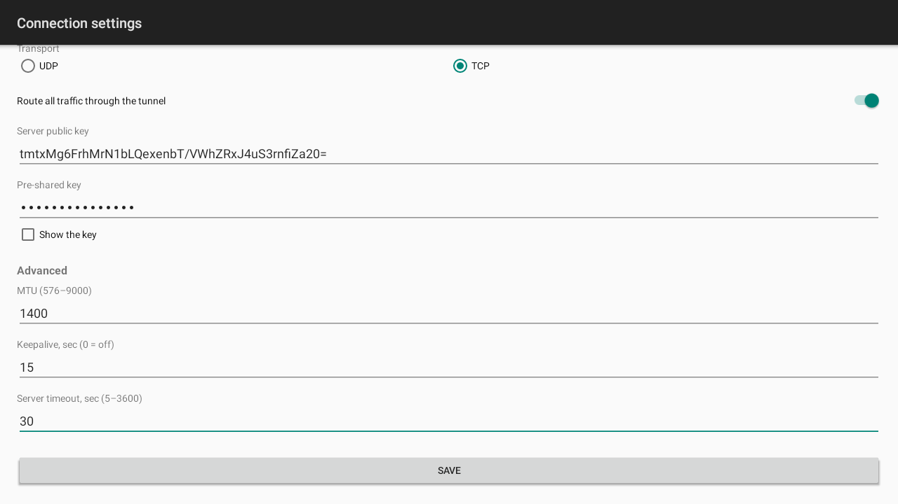

<!-- Copyright (c) OpenIPC  https://openipc.org  MIT License -->

# Android app

`camex-android.apk` of the [`latest`](../README.md#permanent-links) release,
Android 8.0 and later. The app connects in auto mode: the server sends the
address, routes and MTU.

| Main screen                             | Settings                                 |
|-----------------------------------------|------------------------------------------|
|  |  |

## Settings

- **Server host / port** — the camex server.
- **Client name** — the client ID, i.e. the `[client ID]` block on the server.
- **Transport** — UDP or TCP, as on the server.
- **Server public key** and **Pre-shared key** — `--server-pubkey --psk`; the
  key must match the client's `psk=` (or the global key).
- **Route all traffic through the tunnel** — off: only the tunnel network and
  the server's routes go through the tunnel.
- **Advanced** — MTU, keepalive and server timeout.



## VPN and routes

The app uses `VpnService`, so Android shows the VPN key icon while the tunnel
is up. What goes through the tunnel and what does not:
[security.md](security.md#android-app).

## A link with the settings

`install.sh` prints a link with the server's settings next to the client's
command line:

```
Android: open this link on the phone (Telegram, mail, anything):
  https://openipc.github.io/camex/connect/#h=vpn.example.org&p=5800&t=udp&k=<server public key>&s=<psk>
```

Tapped on the phone, it opens the app's settings with the link's values filled
in and their fields marked; nothing is saved or connected until **Save**. A
malformed field is not taken, and the screen says which. The same settings
open with `camex://connect?h=…&p=…` (a QR code, for example).

The settings are after `#`: the browser keeps them, they reach neither GitHub
Pages nor a log. The link has the psk, so it is a password: send it only to
the device's owner. A per-device `psk=` in the device's `[client ID]` block
(see [server.md](server.md)) makes a leaked link revocable.

| Field | Meaning                      | Values                                   |
|-------|------------------------------|------------------------------------------|
| `h`   | server host                  | a host name or an address                |
| `p`   | server port                  | 1–65535                                  |
| `t`   | transport                    | `udp` or `tcp`                           |
| `k`   | server public key            | 44 characters (`camex --genkey`)         |
| `s`   | pre-shared key               | below 128 bytes, `%XX`-encoded as UTF-8  |
| `n`   | client name (optional)       | letters, digits, `.`, `_`, `-`; up to 31 |
| `m`   | MTU (optional)               | 576–9000                                 |
| `a`   | keepalive, s (optional)      | 0–3600                                   |
| `r`   | route all traffic (optional) | `1` or `0`                               |

When the link opens in a browser instead of the app, the page has a button
**Open in Camex** with the same settings, the APK for a phone without the app,
and the command line of the desktop client.

The app opens such links by itself once Android has verified
`https://openipc.github.io/.well-known/assetlinks.json` against the APK's
signing key: [`android/assetlinks.json`](../android/assetlinks.json) is that
file for the release key CI signs with (an APK signed with another key gets
the page and its button).
