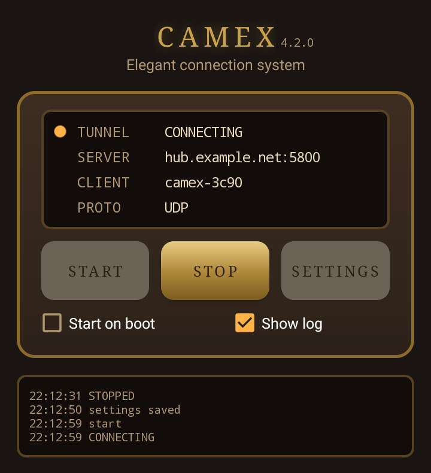
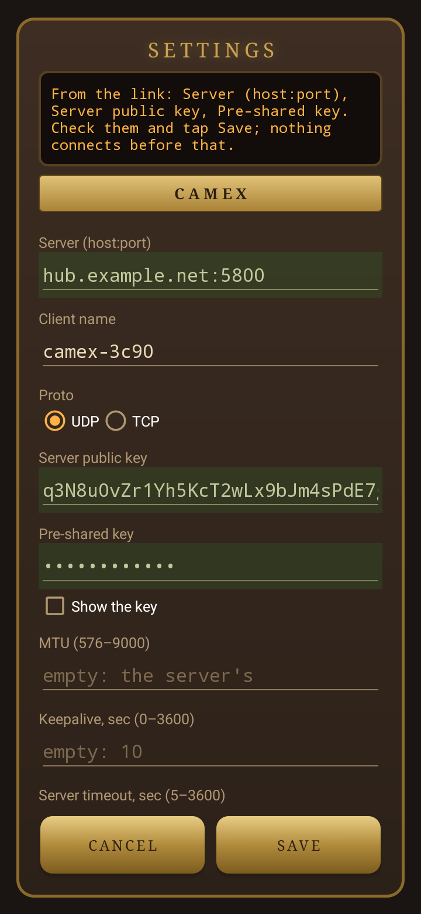

<!-- Copyright (c) OpenIPC  https://openipc.org  MIT License -->

# Android app

`camex-android.apk` of the [`latest`](../README.md#permanent-links) release,
Android 5.0 and later. The app connects in auto mode: the server sends the
address, routes and MTU. It is built on the [Android library](android-library.md)
(since 3.19.0, #172): after **Start** it reconnects by itself until **Stop**. The
screens are in brass (brand brass 1.3.0, 4.3.0): the main screen has the board —
**TUNNEL** with its lamp (green connected with the address, amber connecting or
waiting for the VPN permission, red failed with the reason, colourless stopped),
**SERVER**, **CLIENT** and **PROTO** — and **START**, **STOP** and **SETTINGS** in a
row; under them **Start on boot** (the tunnel with the saved settings after a
reboot, once the VPN permission was given) and **Show log** (the tunnel's states,
the address and the reasons of failures and reconnects, under the panel); both
are off at first.

| Main screen                             | Settings (opened by a link)              |
|-----------------------------------------|------------------------------------------|
|  |  |

## Settings

One **SETTINGS** window, the section **CAMEX** built from the
[library's fields](android-library.md#using-it): their order, labels and the
defaults shown in an empty field are the same in every app on camex.

- **Server (host:port)** — the camex server, its port 5800 by default.
- **Client name** — the client ID, i.e. the `[client ID]` block on the server; a
  new setting starts as `camex-` and the last 4 characters of the device's
  ANDROID_ID (`camex-3f2a`); an empty name is not saved.
- **Proto** — UDP (the default) or TCP, for networks that block UDP; a
  server on both (the default since camex 4.0.0) takes either, an older one
  only the one it was started with.
- **Server public key** and **Pre-shared key** — `--server-pubkey --psk`; the
  key must match the client's `psk=` (or the global key); it is hidden, **Show
  the key** under it shows it.
- **MTU**, **Keepalive** and **Server timeout** — empty: the server's MTU, 10 and
  20 seconds.

## VPN and routes

The app uses `VpnService`, so Android shows the VPN key icon while the tunnel
is up. Only the tunnel network and the server's routes go through it: camex on
Android is for reaching the cameras, not a VPN for all traffic, so there is no
"route all traffic" setting since 3.19.0 (#172). More:
[security.md](security.md#android-app).

## A link with the settings

`install.sh` prints a link with the server's settings next to the client's
command line:

```
Android: open this link on the phone (Telegram, mail, anything):
  https://openipc.github.io/camex/connect/#h=vpn.example.org&p=5800&t=udp&k=<server public key>&s=<psk>
```

Tapped on the phone, it opens the app's settings with the link's values filled
in and their fields marked; nothing is saved or connected until **Save**. A
malformed field is not taken, and the screen says which. The app also takes
`camex://connect?h=…&p=…`, which the page's button sends to it by name; do not
spread such links otherwise (another app may claim `camex://` and get the psk).

The settings are after `#`: the browser keeps them, they reach neither GitHub
Pages nor a log. The link has the psk, so it is a password: send it only to
the device's owner. A per-device `psk=` in the device's `[client ID]` block
(see [server.md](server.md)) makes a leaked link revocable.

| Field | Meaning                                        | Values                                                                                                                                       |
|-------|------------------------------------------------|----------------------------------------------------------------------------------------------------------------------------------------------|
| `h`   | server host                                    | a host name or an IPv4 address, up to 63 characters                                                                                          |
| `p`   | server port                                    | 1–65535                                                                                                                                      |
| `t`   | transport                                      | `udp` or `tcp`                                                                                                                               |
| `k`   | server public key                              | 44 characters (`camex --genkey`), not all zero                                                                                               |
| `s`   | pre-shared key                                 | as camex takes it (`hex:`, `base64:` or a passphrase), below 128 bytes, `%XX`-encoded as UTF-8; no control characters, nothing beyond U+FFFF |
| `n`   | client name (optional)                         | up to 31 bytes of UTF-8, no control characters                                                                                               |
| `m`   | MTU (optional)                                 | 576–9000                                                                                                                                     |
| `a`   | keepalive, s (optional)                        | 0–3600                                                                                                                                       |
| `r`   | route all traffic (ignored since 3.19.0, #172) | `1` or `0`                                                                                                                                   |

When the link opens in a browser instead of the app, the page has a button
**Open in Camex** with the same settings, the APK for a phone without the app,
and the command line of the desktop client.

The app opens such links by itself (an App Link): Android checks
`https://openipc.github.io/.well-known/assetlinks.json` against the APK's
signing key when the app is installed. That file is
[`android/assetlinks.json`](../android/assetlinks.json), for the release key CI
signs with; an APK signed with another key gets the page and its button.
