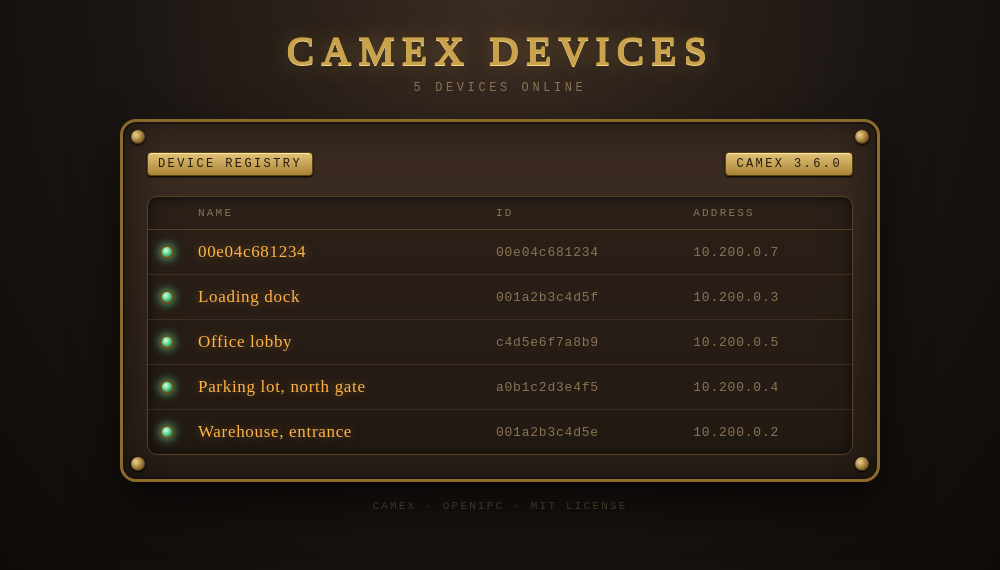
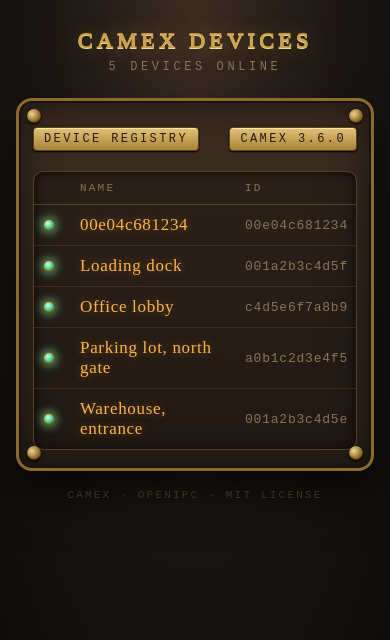

<!-- Copyright (c) OpenIPC  https://openipc.org  MIT License -->

# Deployment with nginx: many cameras, one server, each web UI by name

This guide sets up one Linux host that runs the camex server and nginx side by
side, for many cameras (or other devices) behind NAT. Each camera connects with
camex in auto mode, gets a tunnel address from the server's pool, and its web UI
opens through nginx by name:

```
http://<camera ID>.openipc.click/   →   http://<its tunnel address>:80/
```

Nobody keeps a list of addresses: nginx follows the server's live state through
`camex --status --format nginx-map` and a small sync script. The bare domain,
`http://openipc.click/`, opens a start page with every connected camera, its
name and a link (see [Start page](#start-page)).

## Topology

```
 cameras (behind NAT)                    server host (Linux)
 ┌─────────────────────┐   UDP 5800    ┌─────────────────────────────────────┐
 │ camex --auto        │ ────────────▶ │ camex --mode server                 │
 │   --name <MAC>      │               │   tunnel interface camex/tun0       │
 │ web UI on :80 of    │ ◀── tunnel ── │   pool 10.200.0.0/22                │
 │ its tunnel address  │               │                                     │
 └─────────────────────┘               │ nginx :80/:443 *.openipc.click    │
                                       │   map from camex --status           │
 users ── http(s)://<id>.cam.… ──────▶ │   proxy_pass → <tunnel address>:80  │
                                       └─────────────────────────────────────┘
```

- **camex server**: authenticates the cameras, gives each a stable tunnel
  address (a returning camera gets its address back, #81) and carries their
  traffic. Its control socket answers `camex --status`.
- **nginx**: the only way users reach the cameras. It maps the host name to a
  camera's tunnel address and proxies to it; a name with no live camera gets an
  "offline" page.
- **camex-nginx-sync** (`examples/camex-nginx-sync.sh`): rewrites nginx's map when cameras come or go and
  reloads nginx, and keeps the start page current.

Both run on the same host on purpose: nginx reaches the tunnel addresses
through the server's own tunnel interface, and `camex --status` needs the
server's local control socket.

## Server

On Debian or Ubuntu, `install.sh` does this section and nginx's below in one
command (see [The quick way](#nginx) and
[install.md](install.md)); its `camex.conf` has the
pool, isolation, domain and a new `psk=`, and can be edited as below.

By hand: install camex (see [install.md](install.md#by-hand)), create
the key pair once and give `public_key=` to the cameras:

```sh
sudo mkdir -p /etc/camex
sudo sh -c 'umask 077; camex --genkey > /etc/camex/server.key'
```

`/etc/camex/camex.conf`:

```ini
[server]
# One /22 serves up to 1021 cameras; the server is the first address
local_cidr=10.200.0.1/22
auto_pool=10.200.0.0/22
# No [client ID] list: every camera with the key gets an address
allow_unknown_clients=yes
# Cameras must not reach each other (see Firewall)
client_isolation=yes
# The cameras' domain, for the map and the start page (see nginx)
domain=openipc.click
# One pre-shared key for all devices (see the next section)
psk=hex:<64 hex digits>
```

Start it (or use `examples/camex.service`):

```sh
sudo camex --mode server --port 5800 --config /etc/camex/camex.conf \
    --server-key-file /etc/camex/server.key
```

- Size the pool for the fleet with room to spare: an address stays kept for a
  camera that is gone for at least 12 minutes before another one may get it.
- Addresses are stable: a camera that reconnects, or comes back after a server
  restart, gets its previous address, and the server never gives one address to
  two cameras (#81). The nginx map therefore changes only when cameras come and
  go.
- For 60 seconds after a start the server gives cameras only the address they
  ask for (their previous one), so returning cameras come back first; a new
  camera waits and retries.

## One pre-shared key for all devices

One key for the whole fleet is simple to deploy, and it is acceptable **only on
a network you trust**, such as a company LAN where the cameras and their
firmware are under your control. Know what it allows:

- any device with the key can connect and get an address;
- a device with the key can register under **another camera's ID**: it takes
  over that ID's session and address (also while the camera is online, as a
  reconnect would), so the camera's name in the nginx map leads users to the
  impostor;
- the key is on every camera, so one stolen camera exposes it.

Per-client keys change that: give each camera its own `psk=` in a `[client ID]`
block. A key is then bound to its ID, a device cannot register under another
ID, and `allow_unknown_clients=no` refuses IDs not in the file. The price is a
list to keep: one block per camera.

```ini
[client 001a2b3c4d5e]
name=Warehouse, entrance
psk=hex:<this camera's 64 hex digits>
```

`name=` is optional, with one shared key too: a block with only `name=` gives
the camera a name on the start page. Any `[client ID]` block lists the ID in
the file, though: with `allow_unknown_clients=no` it also lets that camera in,
with the shared key when the block has no `psk=` of its own.

## Cameras

Each camera runs camex in auto mode with its MAC address as the ID, which is
unique and stable:

```sh
camex --mode client --auto --name 001a2b3c4d5e \
    --server-host vpn.example.com --port 5800 \
    --server-pubkey <public_key> --psk hex:<64 hex digits> \
    --tun-dev /dev/camex
```

- **ID**: lower-case hex without separators, so it is a valid host name label
  (`001a2b3c4d5e.openipc.click`). IDs with `:` or `_` are left out of the map
  with a warning.
- **Kernel module**: on OpenIPC cameras without `tun.ko` load `camex.ko` and use
  `--tun-dev /dev/camex` (see [kernel-module.md](kernel-module.md)).
- **NAT**: nothing to forward on the camera's side; the camera connects out.
  The default keepalive (10 s) keeps the NAT mapping open and lets the camera
  notice a lost server within 20 s (`--server-timeout`).

## Firewall

The server's tunnel interface (`camex` with the kernel module, `tun0` or
similar with `/dev/net/tun`; the server logs its name at startup) carries the
traffic between the cameras and the server host. It does **not** carry traffic
from one camera to another: camex delivers that inside the process, so no
firewall rule on the interface can stop it. `client_isolation=yes` drops it
(#83); `camex --status` counts the dropped packets.

An `nftables` example for `camex`: cameras may only answer the server, the
server (nginx) may only open HTTP and ping on them, nothing is forwarded:

```nft
table inet camex {
    chain input {
        type filter hook input priority 0; policy accept;
        # From the cameras to this host: replies only
        iifname "camex" ct state established,related accept
        iifname "camex" drop
    }
    chain output {
        type filter hook output priority 0; policy accept;
        # From this host (nginx) to the cameras: HTTP and ping only
        oifname "camex" ct state established,related accept
        oifname "camex" tcp dport 80 accept
        oifname "camex" icmp type echo-request accept
        oifname "camex" drop
    }
    chain forward {
        type filter hook forward priority 0; policy accept;
        # Nothing routed into or out of the tunnel
        iifname "camex" drop
        oifname "camex" drop
    }
}
```

Load it with `nft -f /etc/nftables.d/camex.nft` (or include it from
`/etc/nftables.conf`). The camex protocol itself (UDP 5800 on the public
interface) is not affected. Keep `net.ipv4.ip_forward=0` unless the host must
route other traffic.

## nginx

The domain is given once. Put it in `[server]` of the server's file:

```ini
[server]
domain=openipc.click
```

The map and the start page take it from the running server (`camex --status`
asks for it), and the sync script needs no setting of its own. `--domain` (or
`DOMAIN=` for the script) still overrides it, with a warning when the two
differ. A reload (`kill -HUP`) applies a new domain. Only camex 3.8.0 or later
reports `domain=`. An older server reports none, so without `--domain` its
clients get the domain of the others, with a warning, or bare IDs when no
server reports one. With an older server, give the domain explicitly
(`--domain`, or `DOMAIN=` for the script): the map and the start page work as
before. The nginx configuration
must name the same domain; `install.sh` below writes it there for you.

**The quick way** (Debian, Ubuntu): `install.sh` installs the camex server
and, with `--domain`, does steps 3 to 5 below in one go, with the domain filled
in everywhere, then checks the result:

```sh
curl -fsSL https://raw.githubusercontent.com/OpenIPC/camex/master/install.sh | sudo sh -s -- --domain openipc.click
```

It installs the nginx server blocks as `/etc/nginx/conf.d/camex-nginx.conf`,
the sync script as `/usr/local/bin/camex-nginx-sync` with its service, and
the start page's password (see [Start page](#start-page),
**Password**). It adds `domain=` to `[server]` of `/etc/camex/camex.conf` and
reloads camex, then checks and reloads nginx and starts the sync service. Run it
again at any time: it updates camex, the sync script and the units; nginx's
file, `camex.conf` and the password, once made, stay as they are, edits
included. The domain is never changed by it: another `--domain` is refused. A
setup of `camex-nginx-setup.sh` (camex 3.9 and before) moves to the new names:
`/etc/nginx/conf.d/camex.conf` becomes `camex-nginx.conf` with its edits, the
old sync script goes to `/var/backups/camex/`, and camex 3.10's
`camex-nginx-sync.timer` is stopped and removed. DNS and TLS (steps 1 and 2) stay
yours.

**The checks**: `camex-nginx-sync --check` goes through the whole setup and
prints one line per item, `ok`, `WARN` or `FAIL`. It checks that the servers
answer, the domain, that nginx includes the map and has `server_name` for the
domain, and what nginx really answers on port 80 of this host: a name under
the domain with no camera must get camex's offline page, and the bare domain
the start page, behind its password (a `WARN` when it has none; with the
password from `/etc/camex/nginx-password`, `PASSWORD_FILE=` for another file,
it also opens the page). Then the start page file, the DNS records and the
sync service. It
exits with 1 on a `FAIL`. A DNS name that does not resolve is a `FAIL`; one
that resolves to an address that is not this host's is a `WARN`, because
behind NAT that is normal. `CHECK_DNS=no` skips the DNS items, e.g. in a
container. After each new map the sync script also logs a warning when there
is no domain, or when nginx has no `server_name` for it or does not include
the map. camex's own warnings (no domain, a bad ID) are logged when they
change, not at every run.

The steps by hand:

1. **DNS**: a wildcard record `*.openipc.click` pointing to the server host,
   and for the start page a record for `openipc.click` itself: a wildcard
   does not cover the bare domain.
2. **TLS** (optional): a certificate for both `*.openipc.click` and
   `openipc.click` (a wildcard certificate does not cover the bare domain
   either); uncomment the `listen 443 ssl` lines in both server blocks of the
   example.
3. **Server block**: copy `examples/nginx-camex.conf` to
   `/etc/nginx/conf.d/camex-nginx.conf`
   and replace `openipc.click` with your domain (the one in `domain=`). It includes the map, proxies
   to the camera with WebSocket support and without buffering, gives up on a
   camera after 5 s and shows an "offline" page for names with no live camera.
4. **The map**: create an empty one so that nginx starts, then let the sync
   script keep it current:

   ```sh
   printf 'map $host $camex_upstream {\n}\n' | sudo tee /etc/nginx/camex-map.conf
   sudo install -m 755 examples/camex-nginx-sync.sh /usr/local/bin/camex-nginx-sync
   sudo cp examples/camex-nginx-sync.service /etc/systemd/system/
   # The domain comes from domain= in [server] of camex.conf
   sudo systemctl daemon-reload
   sudo systemctl enable --now camex-nginx-sync.service
   ```

   The script writes `camex --status --format nginx-map` to the map only when
   it changed, runs `nginx -t` and reloads nginx, and puts the previous map back
   if nginx rejects the new one; runs never overlap (it needs `flock`, from
   util-linux or busybox). When a running server does
   not answer it leaves the map as it is (a socket left behind by a server that
   is gone is skipped).

5. **The start page** (optional): `INDEX=` in the service (set in the
   example) makes the script write it, and `StateDirectory=` creates its
   directory, `/var/lib/camex-nginx`. The second server block of the example
   serves it on the bare domain, behind a password (user `camex`):

   ```sh
   printf 'camex:%s\n' "$(openssl passwd -apr1)" | sudo tee /etc/nginx/camex.htpasswd
   ```

   See [Start page](#start-page).

The map looks like this:

```
# camex --status --format nginx-map: generated, do not edit
# domain: openipc.click
map $host $camex_upstream {
    "001a2b3c4d5e.openipc.click" 10.200.0.2:80;
    "001a2b3c4d5f.openipc.click" 10.200.0.3:80;
}
```

## Start page

`camex --status --format nginx-index --domain openipc.click` prints a static
HTML page of the cameras in two lists, switched with the tabs at the top:

- **Configured**: every `[client ID]` block in the server's file, connected or
  not. A camera that is not connected has a red lamp and no link, so a missing
  one shows at once; the tab counts them ("Configured 5 · 2 offline").
- **Auto**: the connected cameras with no `[client ID]` block, which got their
  address from the auto pool.

Each row has the camera's name linked to `//<camera ID>.openipc.click/` (no
scheme, so the link works over HTTP and HTTPS alike), its ID and tunnel
address, its **Peer**: the external IP it connects from, as the server sees it
(after NAT), linked to `http://<IP>:<peer_port>/` in a new tab; and as in
`camex --status`: **Connected** (how long it has been on
this connection), **Last packet**, **Handshake** (how long ago, and how many
it has had) and **RX / TX** in KiB. The page opens Configured when there are
blocks in the file, Auto otherwise, and the browser remembers the tab chosen
(the tabs work without JavaScript too).

| Desktop                                    | Phone (fewer columns)                                       |
|--------------------------------------------|-------------------------------------------------------------|
|  |  |

- **Peer links**: `peer_port=` in `[defaults]` or in a camera's `[client ID]`
  block sets the port of the link; the camera's own value wins, then
  `[defaults]`, then 8080. With port 80 the link has no port. `peer_port=none`
  shows the IP as plain text: in `[defaults]` for every camera (a camera with
  its own number still gets a link), in a `[client ID]` block for that one. A
  reload (`kill -HUP`) applies it. Only the page has the column: `camex
  --status` keeps its PEER column with the port, the map does not change. A
  camera that is not connected shows `—`, and so does every camera when the
  server is older than 3.9.0. On a phone the column is hidden with Address.

- **Names** come from the server's file: `name=` in the camera's `[client ID]`
  block, UTF-8 text up to 64 bytes without control characters. A camera without
  one is listed by its ID. A reload (`kill -HUP`) applies new names; the server
  refuses to load a file with a name that is not valid. `camex --status` shows
  the names in a NAME column, `--json` as `"name"`.
- **Order**: by name (A–Z in any case alike), then by ID, connected or not, so
  a camera keeps its place in the list.
- **Freshness**: the ages and the traffic are those of the last sync (at
  least every 10 seconds with `--follow` and `INDEX`), and the page reloads itself every 30
  seconds. The script replaces the page at every sync and logs only when the
  number of cameras online changed.
- **The same rules as the map**: IDs that are not a host name label are left
  out with a warning, of an ID on two servers the connected one (then the
  lower address) is kept, and when a running server does not answer nothing
  is printed and the old page stays.
- **DNS and TLS**: the bare domain needs its own DNS record and must be in the
  certificate next to the wildcard (see [nginx](#nginx), steps 1 and 2).
- **With the map**: the script builds the page before the map, so every device
  on it is in the map too, and publishes it only after that map was applied.
  While nginx rejects a new map or does not reload, the page stays as it was,
  so its links never lead to names that nginx does not know yet.
- **Turning it off**: empty `INDEX=` stops the updates only; the script does
  not know which file it wrote before. Remove the start page's server block
  from `nginx-camex.conf` (or the file, e.g. `/var/lib/camex-nginx/index.html`)
  and reload nginx.
- **Password**: the page lists every camera on the server and where it
  connects from, so it always asks for a password (`auth_basic`, user
  `camex`). `install.sh` generates the password once, keeps it in
  `/etc/camex/nginx-password` (root only), writes
  `/etc/nginx/camex.htpasswd` (group `www-data`, other users added there
  stay) and prints it at the end of every run. A run keeps the password; for
  a new one remove `/etc/camex/nginx-password` and run it again (only the
  `camex` line of the htpasswd file changes). The example's block also has
  commented `allow` / `deny` lines, to let in only some networks besides.
- The sync script needs a server of camex 3.7.0 or later for the page: an older
  one answers the page's control command (`CLIENTS INDEX`) with an error, and
  the page is not written (the map still is).

## Checks

- **Who is connected**: `sudo camex --status` lists each camera with its ID,
  address, peer, last packet and traffic (and its `name=` in a NAME column),
  and the addresses kept for cameras that are gone; `--json` gives the same
  for scripts and monitoring.
- **A camera directly**: `curl -sI http://10.200.0.2/` on the server host. No
  answer while `camex --status` lists the camera: the camera's web server, or
  the firewall's output chain.
- **The start page**: `curl -s -u camex:<password> -H 'Host: openipc.click'
  http://127.0.0.1/` on the server host (the password is in
  `/etc/camex/nginx-password`); a 401 means a wrong password, a 404 that the
  page file is missing: compare `INDEX=` with the block's `root` and run the
  sync script by hand.
- **Everything at once**: `sudo camex-nginx-sync --check` (see [nginx](#nginx)).
- **Through nginx**: `curl -sI -H 'Host: 001a2b3c4d5e.openipc.click'
  http://127.0.0.1/`. The offline page means the name is not in the map:
  compare with `camex --status --format nginx-map --domain openipc.click`
  and run the sync script by hand.
- **Logs**: the server logs `Registered auto client <ID>`, `Expired client
  <address>`, address offers and moves, and rejected handshakes (a wrong key, a
  reserved address); `journalctl -u camex-nginx-sync` shows when the map was
  updated and nginx reloaded; nginx's `error.log` shows connection failures to a
  camera.

## Sync script

`examples/camex-nginx-sync.sh`, installed as `/usr/local/bin/camex-nginx-sync`
(POSIX sh). It writes `camex --status --format nginx-map` to the map when it
changed, then checks and reloads nginx; on a failed check the previous map is
put back. With `INDEX` set it also writes the start page (`--format
nginx-index`) when it changed: a static file, so nginx needs no reload for it.
A server that does not answer leaves the map and the page as they are.

```sh
camex-nginx-sync               # once (cron, a systemd timer)
camex-nginx-sync --follow [s]  # at every change of the clients (the service)
camex-nginx-sync --loop 10     # every 10 seconds
camex-nginx-sync --check       # check the whole setup; exit code 1 on a FAIL
```

**`--follow`** (#130), what `camex-nginx-sync.service` runs: a sync as soon
as a client of any server on the host comes, goes, gets another address or
peer, the server's file is reloaded with other names or domain, or a server
starts or stops, within about a second, and none while nothing changes. The start page's live columns
(connected for, last packet, traffic) change without such an event, so with
`INDEX` it also syncs every 10 seconds (without `INDEX` every 300; `--follow
<seconds>` sets it). It waits with `camex --status --wait <token>`: the
servers answer when the state of their clients is not the one in the token,
or when the time is up. A server before camex 3.11.0 does not know the wait:
then the script syncs every 10 seconds and says so once in the log.

Settings (environment; `camex-nginx-sync.service` sets `MAP` and `INDEX`, and
`--check` run by hand takes those from it):

| Variable             | Meaning                                                                                                                         |
|----------------------|---------------------------------------------------------------------------------------------------------------------------------|
| `DOMAIN`             | the domain after the client ID; empty (default): `domain=` in `[server]` of the server                                          |
| `UPSTREAM_PORT`      | the clients' web port (80)                                                                                                      |
| `DEFAULT`            | where unknown names go, `<IPv4>:<port>` (an address: `proxy_pass` with a variable has no resolver); empty: nginx's offline page |
| `CONTROL`            | one server's control socket; empty: every server                                                                                |
| `MAP`                | the map file nginx includes (`/etc/nginx/camex-map.conf`)                                                                       |
| `INDEX`              | the start page, e.g. `/var/lib/camex-nginx/index.html`; empty: no updates; its directory must exist                             |
| `CHECK_DNS`          | `no`: `--check` skips the DNS records (a container, a private network)                                                          |
| `PASSWORD_FILE`      | the start page's password (`/etc/camex/nginx-password`): `--check` opens the page with it                                       |
| `CAMEX`, `NGINX_BIN` | the programs (`camex`, `nginx`; not `NGINX`, which nginx itself reads)                                                          |

## Reference

nginx on the server's host can open the web UI of every client by name,
`http://<client ID>.openipc.click/` → `http://<its tunnel address>:80/`, with
no list of addresses to keep: `camex --status --format nginx-map` prints an nginx
`map` of the live clients, and `examples/camex-nginx-sync.sh` writes it to the
file nginx includes and reloads nginx when it changed.

```sh
sudo camex --status --format nginx-map --domain openipc.click
```

```
# camex --status --format nginx-map: generated, do not edit
# domain: openipc.click
map $host $camex_upstream {
    "cam-a.openipc.click" 10.200.0.2:80;
    "cam-b.openipc.click" 10.200.0.3:80;
}
```

- The host is the client ID in lower case plus the domain: `--domain`, or
  without it `domain=` of the server (the `# domain:` line names it); an ID that is not a
  valid host name label (letters, digits and `-`, up to 63) is left out with a
  warning. `--upstream-port` sets the clients' web port (80), `--default
  <ip:port>` a target for names with no live client. The output is sorted, so
  an unchanged state gives an identical file; when a running server does not
  answer, nothing is printed and the exit code is 1, and the sync script keeps
  the old map (a socket left behind by a server that is gone is skipped).
- `examples/nginx-camex.conf` is the server block: `proxy_pass` to the map's
  target, WebSocket, no buffering, a short connect timeout and an "offline" page
  for names with no live client. `examples/camex-nginx-sync.sh` (POSIX sh) runs
  once, with `--loop <seconds>`, or with `--follow`, as `camex-nginx-sync.service`
  runs it: at every change (see [Sync script](#sync-script)). Addresses are
  stable (#81), so the map changes only when clients come and go.
- **One domain, given once** (#106): `domain=openipc.click` in `[server]` of
  the server's file; the map, the start page and the sync script take it from
  the running server. `install.sh --domain openipc.click` (see
  [install.md](install.md)) sets it there and installs the
  nginx server blocks, the sync script and its service with the same
  domain; `camex-nginx-sync --check` checks the whole setup (servers, domain,
  nginx, start page, DNS).
- Settings of the script: see [Sync script](#sync-script).
- **Start page** (#105, #110): `camex --status --format nginx-index --domain
  openipc.click` prints a static HTML page of the clients in two tabs:
  **Configured**, every `[client ID]` block of the server's file with the
  offline ones in red, and **Auto**, the connected clients from the auto pool.
  Each row has the name linked to `//<client ID>.openipc.click/`, the ID and
  address, the **Peer** (the external IP it connects from, linked to
  `http://<IP>:<peer_port>/` in a new tab; `peer_port=` in `[defaults]` or its
  `[client ID]` block, 8080 by default, `none` for plain text; #119), how long
  it has been connected, its last packet, its last handshake
  and their number, and RX / TX in KiB. The name is `name=` in the client's
  `[client ID]` block on the server (UTF-8, up to 64 bytes), or the ID without
  one; `--status` and `--json` show it too. With `INDEX=` the sync
  script writes the page at every run, and the second server block of
  `examples/nginx-camex.conf` serves it on the bare domain
  (`http://openipc.click/`) behind a password (user `camex`):
  `install.sh` generates it, keeps it in `/etc/camex/nginx-password` and
  prints it (a new one: remove that file and run it again), and `--check` warns when the page has none (#119).
