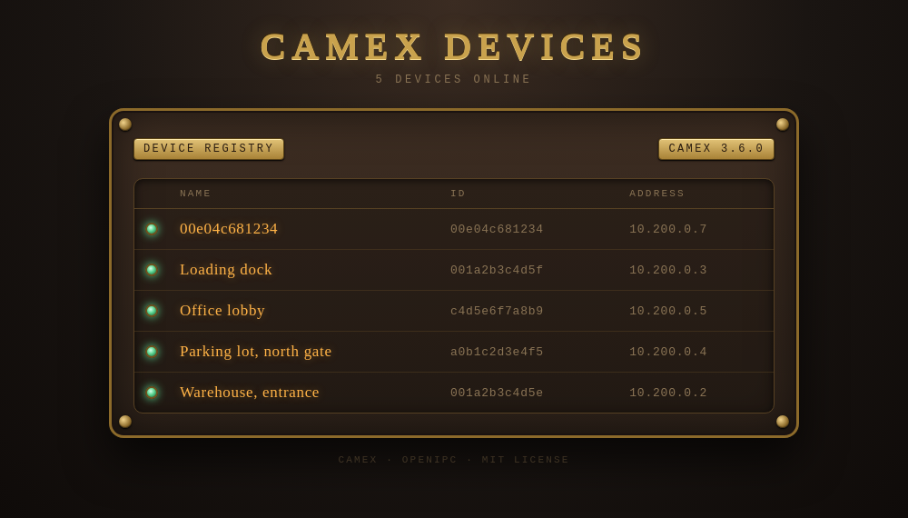
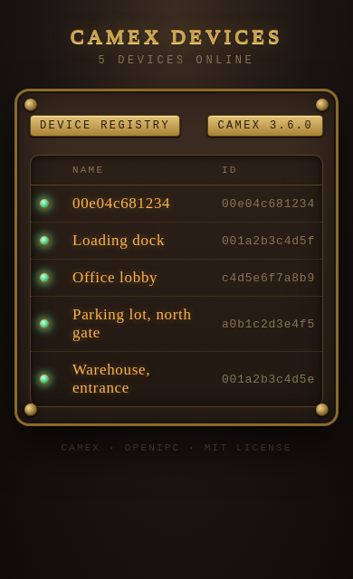

<!-- Copyright (c) OpenIPC  https://openipc.org  MIT License -->

# Deployment with nginx: many cameras, one server, each web UI by name

This guide sets up one Linux host that runs the camex server and nginx side by
side, for many cameras (or other devices) behind NAT. Each camera connects with
camex in auto mode, gets a tunnel address from the server's pool, and its web UI
opens through nginx by name:

```
http://<camera ID>.openipc.click/   →   http://<its tunnel address>:80/
```

Nobody keeps a list of addresses: for every request nginx asks the camex
server where the name goes (`auth_request`), and camex answers from its live
state. The bare domain, `http://openipc.click/`, opens a start page with every
connected camera, its name and a link, which camex serves itself (see
[Start page](#start-page)). No map file, no sync script, no reloads of nginx
(#203).

## Topology

```
 cameras (behind NAT)                    server host (Linux)
 ┌─────────────────────┐   UDP 5800    ┌─────────────────────────────────────┐
 │ camex --auto        │ ────────────▶ │ camex --mode server                 │
 │   --name <MAC>      │               │   tunnel interface camex/tun0       │
 │ web UI on :80 of    │ ◀── tunnel ── │   pool 10.200.0.0/22                │
 │ its tunnel address  │               │   web_listen 127.0.0.1:5801         │
 └─────────────────────┘               │        ▲ where does <id> go?        │
                                       │ nginx :80/:443 *.openipc.click      │
 users ── http(s)://<id>.openipc.… ──▶ │   proxy_pass → <tunnel address>:80  │
                                       └─────────────────────────────────────┘
```

- **camex server**: authenticates the cameras, gives each a stable tunnel
  address (a returning camera gets its address back, #81) and carries their
  traffic. With `web_listen=` it also tells nginx where each name goes
  (`/resolve`) and serves the start page, on 127.0.0.1 only.
- **nginx**: the only way users reach the cameras. For each request it asks
  camex for the camera's tunnel address and proxies to it straight, with no
  traffic through camex; a name with no live device, or a device with no web
  page on its port, gets the page "Device not reachable". It also asks for the
  start page's password and adds TLS.

Both run on the same host on purpose: nginx reaches the tunnel addresses
through the server's own tunnel interface, and camex answers nginx on
127.0.0.1.

## Server

On Debian or Ubuntu, `install.sh` does this section and nginx's below in one
command (see [The quick way](#nginx) and
[install.md](install.md)); its `camex.conf` has the
pool, isolation, domain, `web_listen=yes` and a new `psk=`, and can be edited
as below.

By hand: install camex (see [install.md](install.md#by-hand)), create
the key pair once and give `public_key=` to the cameras:

```sh
sudo mkdir -p /etc/camex
sudo sh -c 'umask 077; camex --genkey > /etc/camex/server.key'
```

`/etc/camex/camex.conf`:

```ini
[server]
# One /22 serves up to 1021 cameras; the server is the first address
local_cidr=10.200.0.1/22
auto_pool=10.200.0.0/22
# No [client ID] list: every camera with the key gets an address
allow_unknown_clients=yes
# Cameras must not reach each other (see Firewall)
client_isolation=yes
# The cameras' domain, for nginx and the start page (see nginx)
domain=openipc.click
# The start page and nginx's lookup on 127.0.0.1:5801 (see nginx)
web_listen=yes
# One pre-shared key for all devices (see the next section)
psk=hex:<64 hex digits>
```

Start it (or use `examples/camex.service`):

```sh
sudo camex --mode server --port 5800 --config /etc/camex/camex.conf \
    --server-key-file /etc/camex/server.key
```

- Size the pool for the fleet with room to spare: an address stays kept for a
  camera that is gone for at least 10 minutes plus `client_timeout=` (11 to 12
  minutes) before another one may get it.
- Addresses are stable: a camera that reconnects, or comes back after a server
  restart, gets its previous address, and the server never gives one address to
  two cameras (#81).
- For 60 seconds after a start the server gives cameras only the address they
  ask for (their previous one), so returning cameras come back first; a new
  camera waits and retries.

## One pre-shared key for all devices

One key for the whole fleet is simple to deploy, and it is acceptable **only on
a network you trust**, such as a company LAN where the cameras and their
firmware are under your control. Know what it allows:

- any device with the key can connect and get an address;
- a device with the key can register under **another camera's ID**: it takes
  over that ID's session and address (also while the camera is online, as a
  reconnect would), so the camera's name in the nginx map leads users to the
  impostor;
- the key is on every camera, so one stolen camera exposes it.

Per-client keys change that: give each camera its own `psk=` in a `[client ID]`
block. A key is then bound to its ID, a device cannot register under another
ID, and `allow_unknown_clients=no` refuses IDs not in the file. The price is a
list to keep: one block per camera.

```ini
[client 001a2b3c4d5e]
name=Warehouse, entrance
psk=hex:<this camera's 64 hex digits>
```

`name=` is optional, with one shared key too: a block with only `name=` gives
the camera a name on the start page. Any `[client ID]` block lists the ID in
the file, though: with `allow_unknown_clients=no` it also lets that camera in,
with the shared key when the block has no `psk=` of its own.

## Cameras

Each camera runs camex in auto mode with its MAC address as the ID, which is
unique and stable:

```sh
camex --mode client --auto --name 001a2b3c4d5e \
    --server-host vpn.example.com --port 5800 \
    --server-pubkey <public_key> --psk hex:<64 hex digits> \
    --tun-dev /dev/camex
```

- **ID**: lower-case hex without separators, so it is a valid host name label
  (`001a2b3c4d5e.openipc.click`). IDs with `:` or `_` get no name in nginx
  with a warning.
- **Kernel module**: on OpenIPC cameras without `tun.ko` load `camex.ko` and use
  `--tun-dev /dev/camex` (see [kernel-module.md](kernel-module.md)).
- **NAT**: nothing to forward on the camera's side; the camera connects out.
  The default keepalive (10 s) keeps the NAT mapping open and lets the camera
  notice a lost server within 20 s (`--server-timeout`).

## Firewall

The server's tunnel interface (`camex` with the kernel module, `tun0` or
similar with `/dev/net/tun`; the server logs its name at startup) carries the
traffic between the cameras and the server host. It does **not** carry traffic
from one camera to another: camex delivers that inside the process, so no
firewall rule on the interface can stop it. `client_isolation=yes` drops it
(#83); `camex --status` counts the dropped packets.

An `nftables` example for `camex`: cameras may only answer the server, the
server (nginx) may only open HTTP and ping on them, nothing is forwarded:

```nft
table inet camex {
    chain input {
        type filter hook input priority 0; policy accept;
        # From the cameras to this host: replies only
        iifname "camex" ct state established,related accept
        iifname "camex" drop
    }
    chain output {
        type filter hook output priority 0; policy accept;
        # From this host (nginx) to the cameras: HTTP and ping only
        oifname "camex" ct state established,related accept
        oifname "camex" tcp dport 80 accept
        oifname "camex" icmp type echo-request accept
        oifname "camex" drop
    }
    chain forward {
        type filter hook forward priority 0; policy accept;
        # Nothing routed into or out of the tunnel
        iifname "camex" drop
        oifname "camex" drop
    }
}
```

Load it with `nft -f /etc/nftables.d/camex.nft` (or include it from
`/etc/nftables.conf`). The camex protocol itself (UDP 5800 on the public
interface) is not affected. Keep `net.ipv4.ip_forward=0` unless the host must
route other traffic.

## nginx

The domain is given once. Put it in `[server]` of the server's file, with
`web_listen=yes`:

```ini
[server]
domain=openipc.click
web_listen=yes
```

camex then listens on `127.0.0.1:5801` for nginx (see [Settings](#settings)).
A reload (`kill -HUP`) applies a new domain or another `web_listen=`. The
nginx configuration must name the same domain; `install.sh` below writes it
there for you. nginx needs `ngx_http_auth_request_module`, which the nginx
packages of Debian and Ubuntu have (`nginx -V 2>&1 | grep -o auth_request`).

**The quick way** (Debian, Ubuntu): `install.sh` installs the camex server
and, with `--domain`, does steps 3 and 4 below in one go, with the domain
filled in everywhere, then opens the start page through nginx to check it:

```sh
curl -fsSL https://raw.githubusercontent.com/OpenIPC/camex/master/install.sh | sudo sh -s -- --domain openipc.click
```

It installs the nginx server blocks as `/etc/nginx/conf.d/camex-nginx.conf`
and the start page's password (see [Start page](#start-page), **Password**).
It adds `domain=` and `web_listen=yes` to `[server]` of
`/etc/camex/camex.conf` (and `device_port=` with `--upstream-port`) and
reloads camex, then checks and reloads nginx. Run it again at any time: it
updates camex; nginx's file, `camex.conf` and the password, once made, stay as
they are, edits included. The domain is never changed by it: another
`--domain` is refused. A server set up by camex 5.1.0 or before (nginx with
the map, `camex-nginx-sync`) is kept as it was: see
[Moving to web_listen](#moving-to-web_listen). DNS and TLS (steps 1 and 2)
stay yours.

The steps by hand:

1. **DNS**: a wildcard record `*.openipc.click` pointing to the server host,
   and for the start page a record for `openipc.click` itself: a wildcard
   does not cover the bare domain.
2. **TLS** (optional): a certificate for both `*.openipc.click` and
   `openipc.click` (a wildcard certificate does not cover the bare domain
   either); uncomment the `listen 443 ssl` lines in both server blocks of the
   example.
3. **Server blocks**: copy `examples/nginx-camex.conf` to
   `/etc/nginx/conf.d/camex-nginx.conf` and replace `openipc.click` with your
   domain (the one in `domain=`). For a camera's name it asks camex
   (`auth_request /_camex_resolve` → `http://127.0.0.1:5801/resolve`), proxies
   to the answer with WebSocket support and without buffering, gives up on a
   camera after 5 s, and shows the page "Device not reachable" for names with
   no live device (camex answers 403), when camex does not answer (500), and
   for a device online with no web page on the port (an Android app on camex
   4.1 or later that does not serve its `web_port` itself refuses it, #187).
   The second block proxies the bare domain to camex's start page, behind a
   password, and never passes on `/resolve`.
4. **The password** of the start page (user `camex`):

   ```sh
   printf 'camex:%s\n' "$(openssl passwd -apr1)" | sudo tee /etc/nginx/camex.htpasswd
   ```

Then `sudo nginx -t && sudo systemctl reload nginx`. Cameras that come and
go need nothing more: nginx asks camex at each request.

What nginx asks, and what camex answers:

```
GET /resolve HTTP/1.0             (from 127.0.0.1 only)
X-Camex-Host: 001a2b3c4d5e.openipc.click

HTTP/1.0 204 No Content
X-Camex-Upstream: 10.200.0.2:80
```

The name is the client ID in lower case plus the domain; nginx's port and the
case do not matter. An ID that is not a valid host name label (letters, digits
and `-`, up to 63) has no name. Of one ID on two servers the lower address is
taken. A name with no live device gets 403, which nginx turns into its page
"Device not reachable".

## Start page

camex serves the start page itself on `web_listen=` (`/`), from the state of
the moment: every request gets the clients as they are now. It shows the
cameras in two lists, switched with the tabs at the top:

- **Configured**: every `[client ID]` block in the server's file, connected or
  not. A camera that is not connected has a red lamp and no link, so a missing
  one shows at once; the tab counts them ("Configured 5 · 2 offline").
- **Auto**: the connected cameras with no `[client ID]` block, which got their
  address from the auto pool.

Each row has the camera's name linked to `//<camera ID>.openipc.click/` (no
scheme, so the link works over HTTP and HTTPS alike; with nginx on a port
other than 80 the link has it: `http://<ID>.openipc.click:8000/`), its ID and
tunnel address, its **Peer**: the external IP it connects from, as the server
sees it (after NAT), linked to `http://<IP>:<peer_port>/` in a new tab; its
**Proto**, UDP or TCP (#178; a dash from a server before 4.0.0); and as in
`camex --status`: **Connected** (how long it has been on this connection),
**Last packet**, **Handshake** (how long ago, and how many it has had) and
**RX / TX** in KiB. The page opens Configured when there are blocks in the
file, Auto otherwise, and the browser remembers the tab chosen (the tabs work
without JavaScript too).

| Desktop                                    | Phone (fewer columns)                                       |
|--------------------------------------------|-------------------------------------------------------------|
|  |  |

- **Web port** (#174): nginx reaches a device's name on port 80 of its tunnel
  address. A device that serves its page on another port (an Android app
  cannot listen below 1024 without root) says so with `--web-port <port>`, or
  the server sets it: `web_port=` in its `[client ID]` block, else the port the
  device announced, else `web_port=` of `[defaults]`, else `device_port=` of
  `[server]` (80). `/resolve` then answers `<address>:<port>` for it; nginx's
  configuration does not change. `camex --status` shows the port after the
  address. Announcing it needs a server 3.19.0 or later: an older server
  refuses a client that sends it.
- **Peer links**: `peer_port=` in `[defaults]` or in a camera's `[client ID]`
  block sets the port of the link; the camera's own value wins, then
  `[defaults]`, then 8080. With port 80 the link has no port. `peer_port=none`
  shows the IP as plain text: in `[defaults]` for every camera (a camera with
  its own number still gets a link), in a `[client ID]` block for that one. A
  reload (`kill -HUP`) applies it. Only the page has the column: `camex
  --status` keeps its PEER column with the port. A camera that is not
  connected shows `—`, and so does every camera when the server is older than
  3.9.0. On a phone the column is hidden with Address.
- **Names** come from the server's file: `name=` in the camera's `[client ID]`
  block, UTF-8 text up to 64 bytes without control characters. A camera without
  one is listed by its ID. A reload (`kill -HUP`) applies new names; the server
  refuses to load a file with a name that is not valid. `camex --status` shows
  the names in a NAME column, `--json` as `"name"`.
- **Order**: the cameras that are not connected first, so one that went down
  is not lost in a long list (#164); within each group by name (A–Z in any
  case alike), then by ID.
- **Browser tab**: the title gives the counts, `3 online, 1 offline · Camex
  Devices`, and the icon is a lamp: green when every camera is online, red
  when one is not, grey while the page gets no answer (then the title starts
  with `No connection ·`). Both work without JavaScript and follow the page's
  refresh.
- **Freshness**: an open page refreshes itself in place every 5 seconds
  (#142): its script fetches the page again and swaps the counts and the
  lists, keeping the chosen tab and the scroll; when the fetch fails or gets
  no answer in 4 seconds (the server down, a new password) the data stays and
  the page says "no connection"; after an update of camex it reloads once.
  Without JavaScript the page reloads every 30 seconds.
- **Every server on the host**: the page lists the clients of every camex
  server on this host, and `/resolve` finds them too (see
  [Several servers on one host](#several-servers-on-one-host)).
- **`/status.json`**: the same as `camex --status --json`, `{"servers":[...]}`,
  behind the same password; for scripts and monitoring.
- **DNS and TLS**: the bare domain needs its own DNS record and must be in the
  certificate next to the wildcard (see [nginx](#nginx), steps 1 and 2).
- **Turning it off**: `web_listen=no` (or no `web_listen=`) and a reload; then
  nginx cannot ask camex either. To keep the lookup but not the page, remove
  the start page's server block from nginx's file.
- **Password**: the page lists every camera on the server and where it
  connects from, so nginx always asks for a password (`auth_basic`, user
  `camex`). `install.sh` generates the password once, keeps it in
  `/etc/camex/nginx-password` (root only), writes
  `/etc/nginx/camex.htpasswd` (group `www-data`, other users added there
  stay) and prints it at the end of every run. A run keeps the password; for
  a new one remove `/etc/camex/nginx-password` and run it again (only the
  `camex` line of the htpasswd file changes). The example's block also has
  commented `allow` / `deny` lines, to let in only some networks besides.

## Without nginx

A server on a LAN, with no nginx, can show the page itself: `web_listen=` on
an address of the LAN, with a password of camex's own.

```sh
camex --hash-password      # asks for it (no echo), prints web_password=...
```

```ini
[server]
web_listen=0.0.0.0:5801
web_password=argon2id$<salt>$<hash>
```

- camex does not start with a `web_listen=` beyond 127.0.0.1 and no
  `web_password=`. `web_password=none` opens the page to anyone who reaches
  it, on purpose, with a warning in the log.
- The file holds only the hash (argon2id with a salt of its own), never the
  password. The browser asks for it (any user name); a password that matched
  is remembered for the run, so the page's refresh does not cost an argon2
  every 5 seconds. 5 wrong passwords in a row from one address shut it out
  for 60 seconds (429), and the log says so.
- Plain HTTP: the password crosses the LAN in the clear. This mode is for a
  network you trust; a page on the internet goes through nginx with TLS.
- Without nginx, each camera's link is its tunnel address and web port
  (`http://10.200.0.2:8080/`): it opens from the server host, and from the LAN
  where it has a route to the pool.
- `/resolve` answers only on 127.0.0.1: the names and addresses never leave
  the host through it.

## Several servers on one host

The server with `web_listen=` asks the others on the host through their
control sockets, every 2 seconds and in the background, and its page and
`/resolve` have their clients too: one domain, every device, as before. A
server that does not answer keeps its part as it last was.

- `web_scope=self`: only its own clients, for a server with its own domain and
  its own `web_listen=` (another port), and its own server blocks in nginx.
- Only one server of a domain should have `web_listen=`.
- One server serves several networks (`[network NAME]`) and both transports
  (UDP and TCP on one port, `--transport both`, the default): one daemon covers
  what used to take several.

## Settings

In `[server]` of the server's file; a reload (`kill -HUP`) applies them.

| Key            | Value                                                                                                                                 |
|----------------|---------------------------------------------------------------------------------------------------------------------------------------|
| `web_listen`   | `yes` (`127.0.0.1:5801`), `no` (the default), `<port>` (on 127.0.0.1) or `<IPv4>:<port>`                                              |
| `web_password` | `argon2id$...` from `camex --hash-password`, or `none`; needed when `web_listen` is beyond 127.0.0.1; behind nginx, nginx asks for it |
| `web_scope`    | `all` (the default: every server on the host) or `self`                                                                               |
| `device_port`  | a device's web port when neither it nor the server's file gives one (80)                                                              |
| `domain`       | the domain after the client ID, in nginx's names and the page's links                                                                 |

| Path           | Answer                                                                                                         |
|----------------|----------------------------------------------------------------------------------------------------------------|
| `/`            | the start page (HTML)                                                                                          |
| `/status.json` | `{"servers":[...]}`, as `camex --status --json`                                                                |
| `/resolve`     | for nginx, from 127.0.0.1 only: 204 with `X-Camex-Upstream: <address>:<port>` for `X-Camex-Host`, 403 for none |

GET and HEAD only, a request head of up to 8 KB, one request per connection;
nothing there changes the server. A camex built without the server or with
`CAMEX_WEB=0` ([build.md](build.md#profiles-and-flags)) has none of it: it
says so in the log and ignores `web_listen=`. Not on Windows.

## Checks

- **Who is connected**: `sudo camex --status` lists each camera with its ID,
  address, peer, last packet and traffic (and its `name=` in a NAME column),
  and the addresses kept for cameras that are gone; `--json` gives the same
  for scripts and monitoring.
- **A camera directly**: `curl -sI http://10.200.0.2/` on the server host. No
  answer while `camex --status` lists the camera: the camera's web server, or
  the firewall's output chain.
- **Where nginx is sent**: `curl -si -H 'X-Camex-Host: 001a2b3c4d5e.openipc.click'
  http://127.0.0.1:5801/resolve` on the server host: 204 with
  `X-Camex-Upstream`, or 403 when no live device has that name. No answer at
  all: `web_listen=` is not set, or camex is not running (`journalctl -u
  camex` has the line `Start page: http://127.0.0.1:5801/`).
- **The start page**: `curl -s -u camex:<password> -H 'Host: openipc.click'
  http://127.0.0.1/` on the server host (the password is in
  `/etc/camex/nginx-password`); a 401 means a wrong password, a 502 that camex
  does not listen on `web_listen=`.
- **Through nginx**: `curl -sI -H 'Host: 001a2b3c4d5e.openipc.click'
  http://127.0.0.1/`. The page "Device not reachable" means no live device has
  this name (compare with `/resolve` above), or the device is online but no
  web page answers on its port (an Android app that does not serve its
  `web_port` itself, #187).
- **Logs**: the server logs `Registered auto client <ID>`, `Expired client
  <address>`, address offers and moves, rejected handshakes (a wrong key, a
  reserved address) and, for a page without nginx, wrong passwords; nginx's
  `error.log` shows connection failures to a camera.

## Moving to web_listen

A server set up with the map and `camex-nginx-sync` (camex 5.1.0 and before)
keeps working after an update: `install.sh` leaves such a setup as it is and
says so. To move it over:

1. Add `web_listen=yes` to `[server]` of `/etc/camex/camex.conf` (and
   `device_port=<port>` if the sync service had `UPSTREAM_PORT=` other than
   80), then `sudo systemctl reload camex`; `curl -si -H 'X-Camex-Host:
   <a camera>.<domain>' http://127.0.0.1:5801/resolve` answers 204.
2. Replace `/etc/nginx/conf.d/camex-nginx.conf` with
   `examples/nginx-camex.conf` (your domain in it, your `listen` and TLS lines
   carried over), then `sudo nginx -t && sudo systemctl reload nginx`.
3. Stop the sync service: `sudo systemctl disable --now camex-nginx-sync`.
4. Remove what is no longer used:

   ```
   /usr/local/bin/camex-nginx-sync
   /etc/systemd/system/camex-nginx-sync.service    (then systemctl daemon-reload)
   /etc/nginx/camex-map.conf
   /etc/nginx/camex-map.conf.applied
   /etc/nginx/camex-map.conf.lock
   /etc/nginx/camex-map.conf.warnings
   /etc/nginx/camex-map.conf.warnings-index
   /var/lib/camex-nginx/
   ```

   The start page's password (`/etc/camex/nginx-password`,
   `/etc/nginx/camex.htpasswd`) stays: the new server blocks use it.

## Sync script (deprecated)

Before camex 5.2.0 nginx followed the server through a map file that this
script kept current. camex now does that itself (`web_listen=`, see
[nginx](#nginx)); the script and `--format nginx-map` / `nginx-index` stay
until camex 6.0.0 for the servers that still use them, and `install.sh` keeps
such a setup as it is. To leave it: [Moving to web_listen](#moving-to-web_listen).


`examples/camex-nginx-sync.sh`, installed as `/usr/local/bin/camex-nginx-sync`
(POSIX sh). It writes `camex --status --format nginx-map` to the map when it
changed, then checks and reloads nginx; on a failed check the previous map is
put back. With `INDEX` set it also writes the start page (`--format
nginx-index`) when it changed: a static file, so nginx needs no reload for it.
A server that does not answer leaves the map and the page as they are.

```sh
camex-nginx-sync               # once (cron, a systemd timer)
camex-nginx-sync --follow [s]  # at every change of the clients (the service)
camex-nginx-sync --loop 10     # every 10 seconds
camex-nginx-sync --check       # check the whole setup; exit code 1 on a FAIL
```

**`--follow`** (#130), what `camex-nginx-sync.service` runs: a sync as soon
as a client of any server on the host comes, goes, gets another address or
peer, the server's file is reloaded with other names or domain, or a server
starts or stops, within about a second, and none while nothing changes. The start page's live columns
(connected for, last packet, traffic) change without such an event, so with
`INDEX` it also syncs every 10 seconds (without `INDEX` every 300; `--follow
<seconds>` sets it). It waits with `camex --status --wait <token>`: the
servers answer when the state of their clients is not the one in the token,
or when the time is up. A server before camex 3.11.0 does not know the wait:
then the script syncs every 10 seconds and says so once in the log.

Settings (environment; `camex-nginx-sync.service` sets `MAP` and `INDEX`, and
`--check` run by hand takes those from it):

| Variable             | Meaning                                                                                                                                        |
|----------------------|------------------------------------------------------------------------------------------------------------------------------------------------|
| `DOMAIN`             | the domain after the client ID; empty (default): `domain=` in `[server]` of the server                                                         |
| `HTTP_PORT`          | nginx's port, in the start page's links and what `--check` asks (80)                                                                           |
| `UPSTREAM_PORT`      | the clients' web port (80)                                                                                                                     |
| `DEFAULT`            | where unknown names go, `<IPv4>:<port>` (an address: `proxy_pass` with a variable has no resolver); empty: nginx's page "Device not reachable" |
| `CONTROL`            | one server's control socket; empty: every server                                                                                               |
| `MAP`                | the map file nginx includes (`/etc/nginx/camex-map.conf`)                                                                                      |
| `INDEX`              | the start page, e.g. `/var/lib/camex-nginx/index.html`; empty: no updates; its directory must exist                                            |
| `CHECK_DNS`          | `no`: `--check` skips the DNS records (a container, a private network)                                                                         |
| `PASSWORD_FILE`      | the start page's password (`/etc/camex/nginx-password`): `--check` opens the page with it                                                      |
| `CAMEX`, `NGINX_BIN` | the programs (`camex`, `nginx`; not `NGINX`, which nginx itself reads)                                                                         |

## Reference

- `web_listen=yes` in `[server]` (#203): camex listens on `127.0.0.1:5801`
  for nginx's lookup (`/resolve`) and serves the start page (`/`) and
  `/status.json`; [Settings](#settings) has the keys, [Without nginx](#without-nginx)
  the page on a LAN with a password of its own.
- `examples/nginx-camex.conf`: the server blocks. `auth_request` asks camex
  where a name goes, `proxy_pass` goes there straight, with WebSocket, no
  buffering, no limit on the upload size (a firmware image through a device's
  web UI; nginx's default is 1 MB), a short connect timeout and the page
  "Device not reachable" for names with no live client or no web page on the
  port; the bare domain proxies to camex's start page behind `auth_basic`.
- **One domain, given once** (#106): `domain=openipc.click` in `[server]` of
  the server's file. `install.sh --domain openipc.click` (see
  [install.md](install.md)) sets it there with `web_listen=yes` and installs
  the nginx server blocks with the same domain.
- **Start page** (#105, #110, #203): two tabs, **Configured** (every
  `[client ID]` block of the server's file, the offline ones in red) and
  **Auto** (the connected clients from the auto pool); each row has the name
  linked to `//<client ID>.openipc.click/`, the ID and address, the **Peer**
  (the external IP it connects from, linked to `http://<IP>:<peer_port>/`;
  `peer_port=`, 8080 by default, `none` for plain text; #119), how long it has
  been connected, its last packet, its last handshake and their number, and
  RX / TX in KiB.
- Until camex 6.0.0 also: `camex --status --format nginx-map` / `nginx-index`
  and `examples/camex-nginx-sync.sh` with `examples/nginx-camex-map.conf`
  (see [Sync script](#sync-script-deprecated)).
